# FinPath Backend Architecture and Database Design

**Status: Task 3.0a APPROVED AND COMPLETE.**

This approved design specifies a modest, modular FastAPI application and PostgreSQL schema that can replace the existing frontend mock data without changing its documented financial rules. Backend infrastructure, all 20 SQLAlchemy table models, and the initial Alembic revision `7270e464aca9` are present. Tasks 3.8c/3.8d added protection functions, triggers, constraints, per-table/column grants, and restricted cleanup to that revision, and real PostgreSQL 17 tests exercise them. Task 3.8e applied and verified the revision on the dedicated `finpath_test` database; Task 4.0 applied and verified it on the development `finpath` database, which is now initialized with the approved schema and seeded reference data. Task 4.1 added the authentication foundation and registration-identity revisions `c7a4e2f19b30`, `e1b9c0d4a7f2`, and `f4a1c2d3e5b6`, applied on both databases. Task 4.2 implemented the authenticated categories/transactions API, owner-scoped CRUD, ETag/idempotency behavior, whole-Kyat validation, and transaction-derived balance calculations without a schema change. Task 4.3 implemented the authenticated Loans API, including owner-scoped loan CRUD (except deletion), derived repayment totals and outstanding principal, idempotent repayment recording, and append-only full-reversal corrections under a loan lock, also without a schema change. Task 4.4 implemented savings-goal create/list/read/update and contribution list/create, with a derived actual balance, goal-row locking, ETags, and scoped idempotency, also without a schema change. Task 4.5 implemented the authenticated dashboard overview, reusing the transaction balance and totals, loan outstanding, and savings balance services in one repeatable-read snapshot, also without a schema change. Task 4.6 implemented the authenticated starting-balance financial-settings API, with owner-scoped retrieval, ETag-protected replacement or paired-null clearing, and safe whole-Kyat validation, also without a schema change. Task 4.7 implemented the authenticated Travel Budget API, and Task 5.9 added explicit trip status and allocation-aware travel recognition through migration `c4f7a1b9e2d6`. Approved roles and transaction categories are seeded by a separate provisioning CLI using the migration identity. Runtime `user_roles` writes remain deferred by explicit decision for Admin management; registration uses the separate least-privilege `finpath_registration` identity. Savings withdrawals/corrections/daily plans and the remaining dashboard reports/CSV are not implemented.

**Task 3.6a.2 account-lifecycle and financial-immutability direction: APPROVED AND COMPLETE. Task 3.8b protection matrix: APPROVED. Tasks 3.8c, 3.8d, 3.8e, 4.0, 4.1, 4.2, 4.3, 4.4, 4.5, and 4.6: COMPLETE. The initial revision `7270e464aca9` and authentication revisions `c7a4e2f19b30`, `e1b9c0d4a7f2`, and `f4a1c2d3e5b6` are verified on `finpath_test` and applied on `finpath`.** The matrix below remains the approved per-table source of truth. The approved `user_roles` runtime write path is deferred by an explicit Task 3.8d decision because the shared runtime identity cannot distinguish an Admin operation from normal registration; registration now uses a dedicated identity that can only assign role ID `1`, while Admin role management and first-admin bootstrap remain blocked pending a separately approved privileged path.

## 1. Architecture overview

Use one FastAPI application backed by PostgreSQL 17, SQLAlchemy 2.x, and Alembic. PostgreSQL 17.11 is installed locally and is the approved development and migration-verification major. Keep the application organized by feature and layer; do not introduce microservices or message queues. Shared authentication rate limiting uses an external service such as Redis, not another PostgreSQL table, preserving the 20-table target.

The request flow is:

1. A versioned API route validates an HTTP request with a Pydantic schema.
2. Authentication dependencies resolve the caller to an active user. Authorization dependencies and services enforce roles and ownership.
3. A feature service applies business rules and coordinates a database transaction.
4. Feature-scoped database access loads or updates SQLAlchemy models using the authenticated user's ID and appropriate row locks.
5. A response schema serializes financial values as integer Kyat (MMK) and dates as ISO date-only strings.
6. Dashboard reporting reads the authoritative records through the same services/query functions; it does not maintain independent totals.

Routes should remain thin. Pydantic schemas define the API contract, SQLAlchemy models describe persistence, and services enforce rules that span records or require atomic updates. Keep database access feature-scoped and explicit rather than creating a generic repository framework. Routes must never accept an owner ID as authority for the requester's identity.

### Account lifecycle and financial-history protection

The user status values are `active`, `suspended`, and `closed`. Active users may use normal application features. Suspended users are temporarily blocked by an administrator; administrators may reactivate them subject to last-active-Admin protection. Closed users are blocked from normal features, their active sessions are revoked, and their user row and financial/audit history are retained. The closure operation and who may initiate it are not specified as routes here; do not treat closure as suspension or add a normal reactivation path for closed accounts. Closed is terminal.

Financial immutability is scoped to historical event records, not blanket table immutability:

- `loan_repayments`: repayment facts are append-only and cannot be edited or deleted. `loan_repayment_corrections` are append-only full reversals; corrections do not alter original amount/date/note. The repayment's derived revision may advance when correction status changes, but event facts remain unchanged.
- `savings_entries`: entries are append-only. Corrections are new opposite-type entries using the existing `correction_of_entry_id` chain and reason; never edit/delete the original or its corrections. Terminal `savings_plan_days` status and snapshots are immutable, while pending schedule rows may be recalculated or rebuilt as specified.
- `admin_audit_logs`: append-only; do not update/delete audit events through normal application operations.
- `idempotency_records`: intentionally mutable during processing, completion, and expiry cleanup; cleanup must not interfere with in-progress operations.
- Other resources remain editable or deletable only where the API contract explicitly permits it, with ownership checks, ETags/revisions, transaction boundaries, and safeguards that preserve historical financial events. This includes permitted transaction/spending edits or deletion and approved trip/budget behavior; it does not authorize loan-repayment deletion or hard deletion of a user.

The policies are not blanket table immutability. The initial revision contains the existing row-level constraints, indexes, and foreign-key actions, plus the Task 3.8c trigger definitions described below. The revision has been applied and verified on `finpath_test` and on the development `finpath` database. Runtime grants and restricted cleanup are implemented in the revision. Service validation/authorization remains required before development use.

### Approved 20-table financial data protection matrix

The matrix describes permitted application operations and the implemented `finpath_app` privileges. `SELECT` is owner-scoped in the service; Admins do not receive access to another user's financial records. The shared runtime database identity cannot itself distinguish users or Admins, so service authorization remains mandatory. Column-level privileges are defense in depth and do not replace service validation. Cleanup is exposed only through a fixed-purpose function, never direct runtime DELETE on operational tables. The trigger and grant definitions are verified on `finpath_test` and deployed on the development `finpath` database by Task 4.0.

| Table | Purpose and read access | INSERT | UPDATE | DELETE | Minimum runtime privileges and database protection | Required tests |
|---|---|---|---|---|---|---|
| `users` | Operational identity; user reads own profile, Admin reads administrative profile only. | Registration or controlled bootstrap; normal registration cannot set privileged roles, bypass verification, or choose arbitrary ownership. | Controlled profile, email-verification, status and revision fields; closed is terminal. | None. | Owner-scoped `SELECT`; restricted `INSERT`/`UPDATE`; no `DELETE`. Closed-state transition trigger is defined in the initial revision. | Registration cannot self-assign Admin or bypass verification; allowed transitions, closed terminal state, session revocation and revision behavior. |
| `roles` | Reference data; read for authorization. | Migration/bootstrap only. | Migration/controlled maintenance only. | Migration/controlled maintenance only. | Runtime `SELECT` only; no runtime writes. | Runtime insert/update/delete denied; only approved role names seeded. |
| `user_roles` | Operational authorization assignments; user sees own roles, Admin manages assignments. | Registration assigns required `user`; Admin/bootstrap may add `admin`. | None; replace assignment through authorized delete/insert. | Authorized Admin may remove `admin`, never required `user`. | Current migration grants `SELECT` only; runtime `INSERT`/`DELETE` are deferred by the approved Task 3.8d decision pending a separately approved privileged path/identity. | Self-promotion denied; required User role retained; last active Admin protected under concurrency; audit failure rolls back change. |
| `admin_audit_logs` | Operational audit; authorized Admin reads audit data, not private financial records. | Authorized user/Admin, bootstrap, or system event. | None; append-only. | None. | `SELECT` for authorized audit path and `INSERT`; no `UPDATE`/`DELETE`. Protect append-only behavior. | Insert succeeds for approved event paths; update/delete denied; audit failure rolls back corresponding mutation. |
| `auth_sessions` | Operational authentication; auth service only. | Login and refresh rotation. | Lifecycle fields only; preserve session identity/token facts. | Eligible expired/revoked cleanup only. | `SELECT`, `INSERT`, restricted `UPDATE`; cleanup only through Task 3.8d's approved narrow mechanism. User cascade is operational cleanup, not financial retention. | Rotation/family invariants, revocation, protected identity fields, cleanup eligibility and user cascade. |
| `auth_action_tokens` | Operational verification/reset; auth service only. | Token issuance. | Single-use consumption state only. | Eligible expired-token cleanup only. | `SELECT`, `INSERT`, restricted `UPDATE`; restricted cleanup mechanism. Preserve purpose/expiry checks and user cascade. | Single-use consumption, purpose/expiry validation, protected fields, cleanup eligibility and user cascade. |
| `idempotency_records` | Operational replay state; service reads only the request's scope. | Create `in_progress` record. | Atomic `in_progress` → `completed`; completed response status/body/headers required. | Eligible expired records only; never delete or disrupt in-progress operations. | `SELECT`, `INSERT`, `UPDATE`; no unrestricted runtime `DELETE`. Cleanup must preserve the approved 24-hour replay behavior and state check. | Valid state/response combinations, complete response headers, replay through 24 hours, and cleanup preserving in-progress rows. |
| `user_financial_settings` | Financial configuration; user reads own row. | Registration creates one row. | Owner updates starting balance/effective date as a valid pair, including clearing both. | None through normal operations. | Owner-scoped `SELECT`, registration `INSERT`, restricted `UPDATE`; no `DELETE`. Preserve pair check and ETag/service validation. | Paired fields, permitted clear, no delete, owner scope and ETag/revision behavior. |
| `transaction_categories` | System-managed reference data; users read active categories and historical labels as needed. | Migration/controlled seeding only. | Controlled retirement (`is_active`) only. | No user deletion. | Runtime `SELECT` only. Preserve uniqueness, type and transaction foreign-key rules. | Runtime writes denied; type/name uniqueness, retirement and historical transaction reference preserved. |
| `transactions` | Editable financial records; owner only. | Owner creates own transaction. | Owner edits permitted fields with `If-Match`. | Owner may delete with `If-Match`. | Owner-scoped `SELECT`, `INSERT`, restricted `UPDATE`, `DELETE`. Preserve amount/type/category checks; service validates ownership, revisions and aggregates. | Cross-owner access denied; stale ETag rejected; valid update/delete reflected in reports; category/type and amount constraints hold. |
| `loans` | Controlled mutable financial aggregate; owner only. | Owner creates own loan. | Owner edits permitted fields; principal cannot fall below valid repayments. | None. | Owner-scoped `SELECT`, `INSERT`, restricted `UPDATE`; no `DELETE`. Preserve positive principal and `RESTRICT` repayment relationship; service locks loan for principal/repayment/correction operations. | Principal cannot undercut valid repayments; concurrent principal/repayment operations cannot overpay; delete denied. |
| `loan_repayments` | Financial fact; owner only. | Valid repayment under parent-loan lock. | Only derived `revision` when correction status changes; all repayment facts immutable. | None. | Owner-scoped `SELECT`, `INSERT`, column-level `UPDATE(revision)`; no `DELETE`. The initial revision trigger rejects fact-field changes and permits only the revision exception. | Amount/date/note/owner/loan immutable; delete denied; only allowed derived revision update succeeds. |
| `loan_repayment_corrections` | Append-only reversal fact; owner only. | One full reversal per repayment. Amount equals original repayment. | None. | None. | Owner-scoped `SELECT`, `INSERT`; no `UPDATE`/`DELETE`. The initial revision trigger checks amount and ownership; existing uniqueness and owner-safe FKs remain. | Amount matches original, second reversal denied, owner/loan links enforced, update/delete denied, original repayment unchanged. |
| `savings_goals` | Controlled mutable goal/archive state; owner only. | Owner creates own goal. | Owner changes permitted metadata or archives/restores with ETag. | None; archive instead. | Owner-scoped `SELECT`, `INSERT`, restricted `UPDATE`; no `DELETE`. Preserve archive/target checks and service-level archived-goal restrictions. | Archive/restore preconditions, archived operations blocked, hard delete denied, history retained. |
| `savings_plans` | Controlled mutable schedule; owner only. | Owner creates the single plan for a goal. | Rebuild/settings changes only before any terminal day; preserve history and recalculate pending schedule atomically. | No normal delete. | Owner-scoped `SELECT`, `INSERT`, restricted `UPDATE`; no `DELETE`. Preserve 1–365 duration and uniqueness; the initial revision blocks schedule changes after terminal history and checks complete pending rebuilds. | Duration bounds; one plan per goal; settings frozen after terminal day; rebuild preserves entries and recalculates pending schedule. |
| `savings_plan_days` | Schedule state and historical snapshots; owner only. Pending rows can be rebuilt; terminal rows are immutable. | Schedule generation. | Pending recalculation/transitions only; completed/missed status and snapshots immutable. | Pending rows only during eligible plan rebuild. | Owner-scoped `SELECT`, `INSERT`, guarded `UPDATE`/`DELETE`. The initial revision blocks terminal-row mutation/deletion and checks pending rebuild consistency; service enforces ordering and carry-forward. | Terminal update/delete denied; pending rebuild allowed; snapshot checks, carry-forward and earlier-overdue-day blocking verified. |
| `savings_entries` | Immutable financial facts/correction chain; owner only. | Contribution, withdrawal, or valid compensating correction. | Only `plan_day_id = NULL` for eligible pending-plan rebuild; all other financial fields remain immutable. | None. | Owner-scoped `SELECT`, `INSERT`, column-level `UPDATE(plan_day_id)`; no `DELETE`. The initial revision enforces immutable facts, correction invariants, and eligible rebuild detachment. | Financial fields immutable; deletion denied; detachment allowed only for eligible pending rebuild; correction amount/type/date/chain rules hold. |
| `trips` | Controlled mutable trip; owner only. | Owner creates own trip. | Owner updates with ETag. | Only explicitly confirmed trip-cancellation workflow. | Owner-scoped `SELECT`, `INSERT`, restricted `UPDATE`, `DELETE` through confirmed workflow. Preserve date check; unused allocation is released while budgets/spending are retained. | Owner/ETag and explicit confirmation enforced; deleting a trip marks it `cancelled` and preserves financial history. |
| `trip_category_budgets` | Controlled mutable planned allocation; owner and trip scoped. | Owner creates same-trip budget. | Owner updates with ETag. | Owner may delete after related spending is detached. | Owner-scoped `SELECT`, `INSERT`, restricted `UPDATE`, `DELETE`. Preserve nonnegative amount and same-trip FK behavior; detachment precedes deletion. | Same-trip ownership/uniqueness; nonnegative amount; deletion detaches but does not delete spending; revision increments. |
| `trip_spending_entries` | Editable financial records, separate from transactions; owner and trip scoped. | Owner creates with optional same-trip budget; unbudgeted is valid. | Owner edits permitted fields with ETag. | Owner may delete with ETag; trip cascade also deletes entries. | Owner-scoped `SELECT`, `INSERT`, restricted `UPDATE`, `DELETE`. Preserve same-trip relationship; budget deletion detaches, confirmed trip deletion cascades. | Unbudgeted valid; cross-trip budget denied; owner/ETag checked; budget detachment preserves record; trip cascade verified. |

#### Cross-row invariants, insert restrictions, and cleanup

**Task 3.8c implementation status (definitions in the initial revision):**

- `prevent_admin_audit_log_mutation` protects `admin_audit_logs`; direct UPDATE/DELETE are rejected while the existing `target_user_id ON DELETE SET NULL` action remains permitted.
- `protect_loan_repayment` protects `loan_repayments`; only a one-step `revision` increment with every other field unchanged is allowed. `validate_loan_repayment_correction` and its append-only trigger protect `loan_repayment_corrections`, checking the original amount and repayment/loan/user ownership.
- `protect_savings_entry` protects `savings_entries`; financial fields and DELETE are rejected, and correction entries are checked for matching amount/date, opposite type, nonblank reason, and valid relationship. `assert_savings_entry_detached_during_rebuild` permits only the approved `plan_day_id` detachment. Existing keys/indexes prevent duplicate correction targets and invalid ownership chains.
- `protect_savings_plan_day` protects `savings_plan_days`; terminal days cannot be changed/deleted, and pending days must retain valid schedule identity. `assert_pending_savings_schedule_rebuilt` checks that pending-day deletion/replacement is complete.
- `protect_savings_plan_schedule` and `assert_savings_plan_schedule_consistent` protect `savings_plans`; schedule settings freeze after terminal history, and pre-terminal schedule changes require a complete matching pending-day rebuild.
- `protect_user_lifecycle` protects `users` from transitions away from `closed` while preserving the approved active/suspended transitions. It does not add a user-delete workflow.
- Added model/migration checks reject empty correction reasons and require a completed-day unpaid-carry snapshot, closing the SQL CHECK `NULL` loophole.

The focused trigger and privilege suites execute these migration DDL definitions on PostgreSQL 17 in isolated temporary schemas, including tests using the actual `finpath_app` identity. The full backend suite passes, and Task 3.8e applied and verified the revision on `finpath_test`; Task 4.0 applied and verified it on the development `finpath` database. Owner authorization, ETags, advisory locks, cleanup invocation, timezone/history rules, and the earlier-overdue-day completion restriction remain service or later-task responsibilities; triggers and grants do not replace them.

- Both services and database protections must enforce: repayment correction amount equals its original repayment; savings corrections use the approved matching amount/opposite type; repayment and savings original financial facts cannot be changed/deleted; terminal plan days cannot be changed/deleted; and savings-entry detachment is limited to eligible pending-plan rebuilds. Task 3.8c supplies narrowly scoped trigger definitions for these cross-row and lifecycle rules in the initial revision; ordinary `CHECK` constraints alone cannot enforce them.
- Restrict `INSERT` columns as well as `UPDATE` columns where needed. Registration must not choose arbitrary ownership identifiers, assign Admin, or bypass verification. Financial ownership and relationship fields must be validated. Column privileges do not replace service authorization, validation, row locking, or same-transaction invariants.
- Do not grant unrestricted runtime `DELETE` for operational cleanup. The initial revision uses a narrowly scoped SECURITY DEFINER function; it may delete only expired sessions/tokens and eligible completed idempotency records, preserves in-progress rows and the 24-hour replay contract, and cannot delete financial history. The invocation schedule remains unspecified.
- **RLS is deferred.** Requests use the shared `finpath_app` identity, which does not identify the authenticated user or Admin to PostgreSQL. Owner scoping and Admin authorization remain service responsibilities. Do not implement RLS or introduce an actor-identity mechanism without later approval; reconsider only if a trustworthy identity design is approved.
- Preserve `admin_audit_logs.target_user_id ON DELETE SET NULL`. No user hard-delete workflow is approved; closure is a terminal tombstone retaining financial history. The possibility that a future hard-delete/legal-erasure process would mutate an append-only audit row is a future review item, not a reason to change this FK now.

#### Implementation status and migration gate

**Already present:** all 20 SQLAlchemy models; the initial revision `7270e464aca9` including Task 3.8c trigger/function definitions, added checks, Task 3.8d per-table/column grants, and restricted cleanup function; PostgreSQL 17 development database; and migration/runtime role separation (`finpath_migrator` owns the database/schema, while `finpath_app` has no ownership or DDL privileges and no migration-role membership). Alembic requires the separate `FINPATH_MIGRATION_DATABASE_URL`. Task 3.8e applied and verified the revision on the dedicated `finpath_test` database, and Task 4.0 applied and verified it on the development `finpath` database. Task 4.1 added registration-identity revisions `c7a4e2f19b30`, `e1b9c0d4a7f2`, and `f4a1c2d3e5b6`, applied and verified on both databases; the single head is `f4a1c2d3e5b6`.

**Implemented in revision `7270e464aca9` and tested in isolated PostgreSQL 17 schemas and on the migrated `finpath_test` database using the actual `finpath_app` identity:** audit, loan repayment/correction, savings entry/plan/day, and closed-user protection triggers; per-table/column DML grants for all 20 tables; and a fixed-purpose cleanup function. The cleanup function deletes only expired action tokens, sessions whose `refresh_expires_at` is at least 30 days in the past (preserving the 30-day refresh-token reuse-detection window after expiry), and completed idempotency records when both `completed_at <= now() - interval '24 hours'` and `expires_at <= now()`. It preserves in-progress/recent idempotency records, active sessions, and all financial-history rows. Direct application DELETE is limited to transactions, pending savings-plan days (trigger guarded), trips, trip budgets, and trip spending.

**Task 4.1 authentication implementation:** registration, email verification, login, signed access tokens, refresh rotation with reuse detection, logout/session revocation, account-status enforcement, change-password, and password reset are implemented under `/api/v1/auth`. Registration writes use the dedicated `finpath_registration` identity, never `finpath_app`. `finpath_app` remains `SELECT`-only on `user_roles`; runtime Admin role management and the first-admin bootstrap remain deferred. Email-change endpoints, shared rate limiting, MFA/passkeys/social login, and a production email provider are also deferred. Email verification is governed by `FINPATH_REQUIRE_EMAIL_VERIFICATION` (default `true`). Local development may disable it to create already-verified accounts without tokens or email delivery; production startup rejects a disabled setting. Existing unverified rows are never rewritten by this setting.

**Task 4.2 transactions implementation:** the authenticated `/api/v1/transactions` CRUD/list routes and read-only `/api/v1/transaction-categories` are implemented with owner scoping, `404 not_found` for inaccessible records, `If-Match`/ETag revision preconditions, idempotent creation and deletion, whole-Kyat entry limits, strict date and category/type validation, cursor pagination, and a cash-movement balance service that reports `not_configured` or `aggregate_out_of_range` as specified. The balance later gained loan cash flow in the account-balance correction, recognized travel expense in Task 5.9, and allocation-aware savings reservation in the balance-accounting correction; savings allocations are reservations rather than expenses. Later Tasks 4.4, 4.5, and 4.6 implemented savings, the dashboard overview, and starting-balance financial settings.

**Task 4.3 loans implementation:** the authenticated `/api/v1/loans` create/list/read/update routes, repayment list/create/read routes, and repayment-correction route are implemented with owner scoping, `404 not_found` for inaccessible records, `If-Match`/ETag preconditions on loan updates, idempotent creation/repayment/correction, strict whole-Kyat and date validation, derived total-repaid and outstanding-principal values, and loan-row locking for principal changes, repayments, and corrections so concurrent operations cannot overpay. Repayment facts remain immutable; corrections append one full-reversal record. Loan deletion remains absent by design. Later Tasks 4.4, 4.5, and 4.6 implemented savings, the dashboard overview, and starting-balance financial settings; travel and the remaining dashboard reports/CSV remain unimplemented.

**Task 4.4 savings implementation:** the authenticated `/api/v1/savings/goals` create/list/read/update routes, the `/api/v1/savings/goals/{goal_id}/entries` list plus contribution/withdrawal create routes, and goal archive/restore are implemented with owner scoping, `404 not_found` for inaccessible records, `If-Match`/ETag preconditions on goal updates and lifecycle changes, idempotent goal, contribution, withdrawal, and archive/restore creation, strict whole-Kyat and date validation, and goal-row locking for contributions, withdrawals, metadata changes, and lifecycle changes. Actual savings is derived as the checked sum of contribution entries less withdrawal entries, so it includes any future compensating correction entries and excludes planned or missed schedule amounts. Goal responses add derived `remaining_kyat = max(0, target_kyat - actual_balance_kyat)`. The target is also the balance allocation: an active goal reserves `max(target, contributions) - withdrawals`, an archived goal reserves its actual balance, and archiving releases the unused remainder. Savings targets are settings rather than individual financial entries and are not subject to the entry cap; contributions are subject to it. Contributions may exceed the target and reserve only the excess. Corrections, daily plans, plan-day transitions, and scheduled-day association remain unimplemented.

**Task 4.5 dashboard implementation:** the authenticated `GET /api/v1/dashboard/overview` route returns one owner-scoped Phase 1 snapshot. It reuses `calculate_account_balance`, the new checked transaction income/expense totals helper, `list_transactions` for newest-first recent rows, `list_loans` for derived outstanding principal/repayment totals and the active-loan count (outstanding principal greater than zero), and `list_goals` for derived actual savings, targets, active counts, and per-goal remaining amounts. The optional `recent_limit` is 1–50 and defaults to 5. All queries run in one repeatable-read transaction so a response cannot mix pre- and post-mutation totals. Income and expenses remain transaction-only; loan repayments and savings contributions are never added to transaction expenses. The account balance includes loan cash flow — borrowed principal and unreversed repayments — exactly once, subtracts the recognized savings allocation once, and does not treat that allocation as an expense. Task 5.9 adds `travel_expense_kyat` and `total_expense_kyat`; recognized travel is counted once in expenses and once in the balance. The response preserves `not_configured` rather than substituting zero when the starting balance or effective date is absent. No schema change was required for the overview itself. Six-month cash flow, expense categories, per-trip rows, the separate report endpoints, and CSV export remain unimplemented.

**Task 4.6 financial-settings implementation:** the authenticated `GET` and `PUT /api/v1/users/me/financial-settings` routes use the Task 4.1 `get_current_auth` dependency and the `finpath_app` runtime identity. Both operate only on the caller's single registration-created `user_financial_settings` row; there is no client-supplied user identifier, so a caller cannot read or write another user's settings. `GET` returns the Dashboard's account-balance resource shape (`status`, `starting_balance_kyat`, `effective_date`, `amount_kyat`, `as_of_date`) and a quoted strong `ETag` derived from `user_financial_settings.revision`, reading the settings row and derived balance in one repeatable-read snapshot. `PUT` requires the current `If-Match`, locks the settings row, replaces both fields together, increments the revision atomically, and returns the updated resource and ETag; missing preconditions return `428 precondition_required`, and malformed or stale values return `412 stale_revision`. Both fields may be null together to clear the setting, returning `not_configured` and a null amount; one null and one non-null, missing fields, or unknown fields return `422 validation_error`. Starting balance may be zero or negative and is a setting rather than an individual financial entry, so the configurable entry cap does not apply; values must be whole JSON integers within the safe integer range, and floats, strings, booleans, and unsafe values are rejected without rounding. `effective_date` accepts only a real local-calendar `YYYY-MM-DD` date. The Dashboard continues to use the shared `calculate_account_balance` service, preserving the cash-movement formula and inclusive opening-balance date boundary. No schema change or migration was required because registration already creates the row and `finpath_app` already holds the necessary `SELECT` and column-level `UPDATE` privileges.

**Registration identity permission boundary:** `finpath_registration` is a login-only role with no `SUPERUSER`, `CREATEDB`, `CREATEROLE`, `REPLICATION`, or `BYPASSRLS`; no database, schema, or table ownership; no membership in `finpath_migrator` or any other role; and no grant option. It has only the column-level INSERT privileges needed for registration (`users`, `user_roles`, `user_financial_settings`, `auth_action_tokens`, `idempotency_records`), no `SELECT` on `users.email`, no access to financial tables, and no INSERT/UPDATE/DELETE on `auth_sessions`. Two non-`SECURITY DEFINER` trigger functions enforce the boundary: `enforce_registration_role_assignment` rejects any `user_roles.role_id` other than `1` from this identity, and `enforce_registration_action_token` restricts token writes to `token_type = 'email_verification'` with `target_email IS NULL`. Both functions are owned by `finpath_migrator`, fix `search_path` to `pg_catalog`, and have EXECUTE revoked from `PUBLIC`, `finpath_app`, and `finpath_registration`; trigger invocation does not require caller EXECUTE. Public registration therefore cannot assign Admin or mint password-reset/email-change tokens.

#### Exact runtime grants in revision `7270e464aca9`

For each listed table the migration explicitly revokes all table privileges from both `PUBLIC` and `finpath_app`, then grants only the following. Unlisted columns have no runtime INSERT/UPDATE privilege. Every table grants `SELECT`. No table grants table-level INSERT or UPDATE; column privileges are used instead.

| Table | INSERT columns | UPDATE columns | DELETE |
|---|---|---|---|
| `roles` | — | — | No |
| `transaction_categories` | — | — | No |
| `users` | `id, email, password_hash, timezone` | `email, password_hash, email_verified_at, pending_email, status, timezone, revision, updated_at` | No |
| `user_roles` | — (deferred) | — | No (deferred) |
| `admin_audit_logs` | `id, actor_type, actor_user_id, action, target_user_id, target_type, target_id, details` | — | No |
| `auth_sessions` | `id, user_id, session_family_id, refresh_token_hash, refresh_expires_at` | `last_refreshed_at, revoked_at, replaced_by_session_id` | Cleanup function only |
| `auth_action_tokens` | `id, user_id, token_type, token_hash, target_email, expires_at` | `consumed_at` | Cleanup function only |
| `idempotency_records` | `id, owner_user_id, principal_scope_hash, http_method, route_key, key_hash, request_hash, expires_at` | `state, response_status, response_body, response_headers, completed_at` | Cleanup function only |
| `user_financial_settings` | `user_id, starting_balance_kyat, effective_date` | `starting_balance_kyat, effective_date, revision, updated_at` | No |
| `transactions` | `id, user_id, category_id, type, description, amount_kyat, transaction_date` | `category_id, type, description, amount_kyat, transaction_date, updated_at, revision` | Yes |
| `loans` | `id, user_id, name, principal_kyat, start_date` | `name, principal_kyat, start_date, updated_at, revision` | No |
| `loan_repayments` | `id, user_id, loan_id, amount_kyat, repayment_date, note` | `revision` only | No |
| `loan_repayment_corrections` | `id, user_id, loan_id, repayment_id, type, amount_kyat, reason, created_by_user_id` | — | No |
| `savings_goals` | `id, user_id, name, target_kyat, tone` | `name, target_kyat, tone, status, archived_at, revision, updated_at` | No |
| `savings_plans` | `id, user_id, goal_id, start_date, duration_days, daily_amount_kyat` | `start_date, duration_days, daily_amount_kyat, updated_at, revision` | No |
| `savings_plan_days` | `id, user_id, goal_id, plan_id, day_number, planned_date, base_amount_kyat, carried_forward_kyat, required_amount_kyat` | `day_number, planned_date, base_amount_kyat, carried_forward_kyat, required_amount_kyat, status, completion_date, actual_amount_kyat, reconciled_contributions_kyat, unpaid_carry_forward_kyat` | Yes, trigger permits pending rebuild only |
| `savings_entries` | `id, user_id, goal_id, plan_day_id, entry_type, amount_kyat, entry_date, note, correction_of_entry_id, correction_reason` | `plan_day_id` only | No |
| `trips` | `id, user_id, name, destination, start_date, end_date` | `name, destination, start_date, end_date, updated_at, revision` | Yes |
| `trip_category_budgets` | `id, user_id, trip_id, category, budget_kyat` | `category, budget_kyat, updated_at, revision` | Yes |
| `trip_spending_entries` | `id, user_id, trip_id, category_budget_id, category, description, amount_kyat, spending_date` | `category_budget_id, category, description, amount_kyat, spending_date, updated_at, revision` | Yes |

`finpath_app` has no table ownership, schema CREATE, database CREATE, migration-role membership, or grant option. The fixed, zero-argument `SECURITY DEFINER` function `public.cleanup_expired_operational_records()` is owned by `finpath_migrator`, fixes `search_path` to `pg_catalog`, schema-qualifies every table, and has EXECUTE revoked from `PUBLIC`; only `finpath_app` receives EXECUTE. It returns the number of deleted rows and accepts no caller-supplied SQL, table names, or predicates. It deletes tokens only at `expires_at <= now()`, sessions only at `refresh_expires_at <= now() - interval '30 days'` (retaining revoked/expired rows through the 30-day reuse-detection window and never deleting active sessions), and idempotency rows only when `state = 'completed'`, `completed_at <= now() - interval '24 hours'`, and `expires_at <= now()`. No cleanup frequency is set. Invocation must remain an internal maintenance action, not an end-user API. No additional role provisioning prerequisite was needed; the migration-created function uses the existing migration owner, and no role or membership was changed.

#### Reference-data seeding and first-admin bootstrap

Roles (`user`, `admin`) and the predefined first-release transaction categories are **not** inserted by the migration. They are seeded by a separate idempotent provisioning CLI that runs with the migration/provisioning identity:

```sh
cd backend
.venv/bin/python -m app.db.seed
```

Prerequisites: the initial revision must already be applied to the target database, and `FINPATH_MIGRATION_DATABASE_URL` must be set to the `finpath_migrator` connection. The command rejects the runtime `finpath_app` identity. It inserts only the two approved roles and the eleven approved categories, uses stable identifiers (`roles.id` `1 = user`, `2 = admin`; category UUIDs derived with `uuid5` from the fixed namespace `6f1a5c2e-8b7d-4c3a-9e2f-1a2b3c4d5e6f`), never updates or deletes existing rows, and fails loudly if an identifier or name conflicts with unexpected data. Re-running it inserts nothing and preserves operator-maintained values. It is not a runtime API and does not grant `finpath_app` any write privilege on `roles` or `transaction_categories`.

The first Admin remains a **separate, explicit bootstrap operation**, not part of the seed. It must run with controlled server access, accept credentials through a secure interactive prompt or protected secret channel (never command-line arguments or a public route), verify that no Admin assignment already exists, create or designate the account with the required `user` role plus additive `admin`, write the `bootstrap_admin_created` audit event in the same transaction, and roll back on audit failure. No default Admin password or hardcoded production credential is created. The bootstrap cannot be implemented until the privileged `user_roles` write path below is approved.

**Deferred by approval:** PostgreSQL RLS and any new database actor-identity mechanism.

### Suggested folder structure

```text
backend/
  pyproject.toml
  alembic.ini
  .env.example
  app/
    __init__.py
    main.py
    cli.py
    api/
      __init__.py
      deps.py
      errors.py
      v1/
        __init__.py
        router.py
        auth.py
        users.py
        transactions.py
        loans.py
        savings.py
        travel.py
        dashboard.py
        admin.py
    core/
      config.py
      security.py
      permissions.py
    db/
      base.py
      session.py
      seed.py
    models/
      __init__.py
      auth.py
      idempotency.py
      user.py
      transaction.py
      loan.py
      savings.py
      travel.py
      audit.py
    schemas/
      common.py
      auth.py
      user.py
      transaction.py
      loan.py
      savings.py
      travel.py
      dashboard.py
      admin.py
    services/
      auth.py
      idempotency.py
      users.py
      transactions.py
      loans.py
      savings.py
      travel.py
      dashboard.py
      admin.py
    data_access/
      auth.py
      idempotency.py
      users.py
      transactions.py
      loans.py
      savings.py
      travel.py
      audit.py
  migrations/
    env.py
    versions/
  tests/
    conftest.py
    unit/
    integration/
    api/
```

### Layer responsibilities

| Layer | Responsibility |
|---|---|
| `api/v1/` | HTTP methods, paths, status codes, dependency wiring, and versioned routers. Routes call services; they do not implement financial rules or build unscoped queries. |
| `schemas/` | Pydantic request/response types, basic shape and format validation, and explicit serialization. API financial fields use integer Kyat with names ending in `_kyat`; date-only fields use `YYYY-MM-DD`. |
| `services/` | Use-case and business-rule enforcement, ownership checks, transaction boundaries, row locking for concurrent financial mutations, and orchestration of data access. |
| `models/` | SQLAlchemy mappings, PostgreSQL types, foreign keys, uniqueness, and row-level checks that can be represented in the database. |
| `data_access/` | Feature-scoped, parameterized SQLAlchemy queries. Functions take the authenticated owner ID and return only records in that scope. |
| `core/` | Validated configuration, token/password helpers, authentication, and centralized permission rules. |
| `db/` | Engine, session lifecycle, declarative base, and dependency integration. |
| `migrations/` | Reviewed, versioned Alembic changes. Schema creation and updates must not happen implicitly at application startup. |
| `tests/` | Unit tests for deterministic rules; PostgreSQL-backed integration tests for constraints, locking, and transactions; API tests for authentication and authorization boundaries. |

Use Pydantic Settings (or an equivalent typed settings layer) to read secrets and environment-specific values from environment variables. `.env.example` contains names and safe placeholders only; real secrets stay local. Keep production credentials, signing keys, and database URLs out of source control. Use separate application and migration database credentials where practical.

Self-registration is enabled. Registration must create the user, assign the required `user` role, and create exactly one `user_financial_settings` row in the same database transaction. The starting balance and effective date may both remain null until the user enters them. Every registered account must retain the `user` role. The `admin` role is additive and may be granted or removed independently only by an authorized administrator; users cannot remove their own required `user` role or grant themselves `admin`. Role and account-status changes must be audited.

Use Argon2id for password hashing and require at least 12 password characters. No mandatory uppercase, number, or symbol rules are approved; password complexity beyond the minimum remains unresolved. Access tokens last 15 minutes. Refresh tokens are opaque, stored only as hashes, rotate on every use, have a 30-day absolute lifetime and a 7-day inactivity lifetime, and trigger family-wide revocation if an already-rotated token is reused. Logout revokes the applicable refresh session. A protected request checks session revocation/expiry, current account status, and email verification; suspension or closure revokes active sessions in the same transaction. Suspended and closed accounts cannot access normal features; closed accounts are terminal. Email-verification tokens expire after 24 hours and password-reset tokens after 30 minutes. Email verification is required before normal authenticated access in production: unverified users may only register, verify their email, or request/resend verification, and cannot access financial features, dashboard data, or other normal application APIs. Valid credentials for an unverified account do not issue tokens or a refresh cookie. Local development may disable verification through `FINPATH_REQUIRE_EMAIL_VERIFICATION`; production rejects that setting.

Use shared rate limiting across backend workers, backed by an external service such as Redis. Fail closed for sensitive authentication operations if rate limiting cannot be enforced and return `429 Too Many Requests` when limited. Initial limits are 5 failed login attempts per account per 15 minutes, 5 registration attempts per IP per hour, 3 password-reset requests per account per hour, and 3 verification resends per account per hour. Redis hosting and connection configuration remain operational decisions; do not add a rate-limiting table.

For browser authentication, use a host-only `HttpOnly; Secure; SameSite=Lax` refresh cookie scoped to `/api/v1/auth`; do not store refresh tokens in browser-accessible storage. Login, refresh, logout, and CSRF-token retrieval validate the exact configured `Origin`. Refresh and logout require a session-family-bound synchronizer token in `X-CSRF-Token`; return it in JSON and re-issue it through a read-only CSRF endpoint after reload. A signed token bound to the current session family and short expiry can be verified without persisting its raw value. Validate `Sec-Fetch-Site` when present as defense in depth. Credentialed CORS must use an explicit origin allowlist, never `*`; deployment-specific cookie/CORS settings require review. For an identifiable suspended or closed account, check status before treating its revoked session as an ordinary invalid session and return a distinct forbidden account-state response; otherwise unknown, expired, or revoked sessions return `401`.

An active administrator is a user whose account status is `active` and who holds the `admin` role. All Admin role and account-status mutations must be serialized using a PostgreSQL transaction-scoped advisory lock with one application-wide lock key. Do not add a coordination table. Within that serialization, re-read the affected user, validate the supplied ETag against its current revision, and, for any operation that may reduce the active-Admin count, re-read that count and reject any operation that would leave no active administrator.

For the initial version, an administrator has the ordinary user capabilities for their own account plus administrative capabilities to manage users, roles, account status, and audit logs. Administrative permissions do not grant access to other users' private financial records. Keep administrative authorization distinct from owner-scoped financial queries.

## 2. Shared data conventions

- **Primary identifiers:** PostgreSQL `UUID`, generated by the application or database. Existing seeded IDs such as `tx-01` are mock identifiers; API and persisted IDs should be UUIDs, still serialized as strings to TypeScript.
- **Currency:** MMK only for the initial release. Store whole Kyat as integer `BIGINT` values; there are no fractional Kyat amounts or currency conversion.
- **Kyat values:** Persist and expose financial amounts as integer Kyat. Use semantically explicit names ending in `_kyat` (for example, `amount_kyat`, `principal_kyat`, and `starting_balance_kyat`) throughout the API and database.
- **Individual-entry limit:** The configurable backend setting `MAX_FINANCIAL_ENTRY_KYAT` defaults to `1_000_000_000` (one billion MMK) and applies to transaction amounts, loan principal/repayments, savings contributions/withdrawals, and trip-spending entries. It is service/schema validation, not a database maximum constraint. Starting-balance settings, savings targets/plans, and category-budget allocations are not financial entries; validate them within `BIGINT` and the frontend JSON integer's safe range. Independently check all aggregates before serializing.
- **Dates:** PostgreSQL `DATE` for financial date-only values. Serialize as ISO `YYYY-MM-DD`; do not reinterpret dates through UTC timestamps.
- **Event timestamps:** `TIMESTAMPTZ` stored in UTC for creation, update, completion, and audit events. These are not substitutes for financial dates.
- **Initial account scope:** One financial account/ledger per user. All of a user's transactions belong to that single ledger; there is no separate `accounts` table in the initial version.
- **Starting balance:** One `user_financial_settings` row per user stores at most one manually entered starting balance and effective date.
- **Ownership:** Financial tables carry `user_id` and use composite foreign keys to ensure nested records belong to the same owner and parent.
- **Soft status:** Users are suspended rather than deleted as a routine account-management operation. Financial record retention and permanent erasure require a product/legal retention decision.

For every ETag-protected mutation, compare the expected validator with the persisted `revision` inside the same transaction as the write, using a row lock or conditional update. On success increment the resource revision and every affected parent revision atomically; stale validators fail without partial changes. Do not validate a revision in a separate read and then write unconditionally.

## 3. Proposed relational tables

The table designs below use `created_at TIMESTAMPTZ NOT NULL DEFAULT now()` and `updated_at TIMESTAMPTZ NOT NULL DEFAULT now()` where mutable records need them. Update timestamps are maintained by the application or a consistent database mechanism. `id UUID PRIMARY KEY` is shown where not otherwise specified. All money columns are `BIGINT` whole-Kyat fields named with `_kyat`; apply the configurable one-billion-Kyat cap in backend validation, not as a fixed per-entry database maximum.

### Users and authorization

#### `users`

| Column | PostgreSQL type | Rules |
|---|---|---|
| `id` | `UUID` | Primary key. |
| `email` | `VARCHAR(320)` | Required; unique case-insensitively (for example, unique index on `lower(email)`). Normalize before storing. |
| `password_hash` | `VARCHAR(255)` | Required; password hash only, never a plaintext password. |
| `email_verified_at` | `TIMESTAMPTZ` | Nullable; set only after successful one-time email verification. |
| `pending_email` | `VARCHAR(320)` | Nullable; new address awaiting verification; active `email` remains unchanged until promotion. |
| `status` | `VARCHAR(16)` | Required; target constraint is `CHECK (status IN ('active', 'suspended', 'closed'))`, default `active`. `active` permits normal access; `suspended` is a temporary administrative block; `closed` is an irreversible retained tombstone with no normal application access. |
| `timezone` | `VARCHAR(64)` | Required IANA timezone used for server-side date decisions; approved registration default is `Asia/Yangon`. Users may change it in settings. |
| `revision` | `BIGINT` | Required, starts at 1; increment for every change that affects an ETag-protected user representation, including profile, role, account status, active email, pending email, or email-verification status. |
| `created_at`, `updated_at` | `TIMESTAMPTZ` | Required. |

Keep active and pending addresses unique case-insensitively with separate unique indexes on `lower(email)` and non-null `lower(pending_email)`. Index `status` for administrative account-status filtering. Validate `timezone` against the IANA database in the service. Status is checked on protected requests so a previously issued token cannot keep a suspended or closed user active. Revoke active sessions atomically when status becomes `suspended` or `closed`. The permitted state transitions are `active -> suspended` or `closed`, and `suspended -> active` or `closed`; `closed` is terminal and cannot be reactivated through normal self-service or administrator workflows. Closure initiation and response details remain API/service implementation work. Increment the user revision in the same transaction whenever any represented value changes, including when a verification token sets `email_verified_at`, an email-change request sets/replaces `pending_email`, successful email-change verification promotes the address and clears `pending_email`, or status changes.

The SQLAlchemy `User` model and initial migration permit exactly `active`, `suspended`, and `closed`. The check is present; status-transition and terminal-closure behavior remain service/database-protection implementation work.

#### `roles`

| Column | PostgreSQL type | Rules |
|---|---|---|
| `id` | `SMALLINT` | Primary key. |
| `name` | `VARCHAR(32)` | Required, unique; initially seed `user` and `admin`. |
| `description` | `VARCHAR(200)` | Optional. |

#### `user_roles`

| Column | PostgreSQL type | Rules |
|---|---|---|
| `user_id` | `UUID` | Required FK to `users.id`, `ON DELETE RESTRICT`. |
| `role_id` | `SMALLINT` | Required FK to `roles.id`, `ON DELETE RESTRICT`. |
| `granted_by_user_id` | `UUID` | Nullable FK to `users.id`, `ON DELETE SET NULL`; identifies the administrator who assigned it. |
| `granted_at` | `TIMESTAMPTZ` | Required, defaults to `now()`. |

Primary key `(user_id, role_id)`; index `(role_id, user_id)`. A separate role table and join table are recommended over a role column: they support explicit role assignment and multiple roles without putting account-specific permissions in client claims. Seed only the two required role names. Assign `user` at registration and retain it when granting `admin`, making Admin additive to User capabilities for the administrator's own account. Only an authorized Admin can grant or remove `admin`, except the first Admin created by the controlled one-time bootstrap CLI; users cannot promote themselves or remove their required `user` role. Every administrative action still requires explicit server-side authorization. Serialize all Admin role/status mutations with the shared lock; reject any change that could leave no active Admin. Commit each role/status mutation and its audit row in the same transaction; roll back the mutation if audit recording fails.

#### `admin_audit_logs`

| Column | PostgreSQL type | Rules |
|---|---|---|
| `id` | `UUID` | Primary key. |
| `actor_type` | `VARCHAR(16)` | Required; `CHECK (actor_type IN ('user', 'bootstrap_cli', 'system'))`. |
| `actor_user_id` | `UUID` | Nullable FK to `users.id`, `ON DELETE RESTRICT` while retained; required for `actor_type = 'user'`, null for `bootstrap_cli` or `system` (enforce with a check). |
| `action` | `VARCHAR(80)` | Required, controlled action name, such as role or status change. |
| `target_user_id` | `UUID` | Nullable FK to `users.id`, `ON DELETE SET NULL`. |
| `target_type` | `VARCHAR(80)` | Required resource type. |
| `target_id` | `UUID` | Nullable resource ID; do not cascade-delete audit history with a target. |
| `occurred_at` | `TIMESTAMPTZ` | Required, defaults to `now()`. |
| `details` | `JSONB` | Optional allowlisted operational metadata; never store passwords, tokens, or unnecessary private financial details. |

Add `CHECK ((actor_type = 'user' AND actor_user_id IS NOT NULL) OR (actor_type IN ('bootstrap_cli', 'system') AND actor_user_id IS NULL))`. Indexes `(actor_user_id, occurred_at DESC)` and `(target_user_id, occurred_at DESC)`. Audit rows are append-only; Admins may review them but cannot edit or delete them through the API. Restrict this table to authorized audit functions and administrative queries; audit access does not imply access to private financial records. Record refresh-token reuse as a security event without storing the token. The one-time bootstrap CLI writes a `bootstrap_admin_created` row with `actor_type = 'bootstrap_cli'`, no actor user ID, and the created Admin as target in the same transaction; if the audit write fails, roll back bootstrap.

#### `auth_sessions`

| Column | PostgreSQL type | Rules |
|---|---|---|
| `id` | `UUID` | Primary key; referenced by access tokens as the server-side session identifier. |
| `user_id` | `UUID` | Required FK to `users.id`, `ON DELETE CASCADE`; session data is not financial history. |
| `session_family_id` | `UUID` | Required; stable identifier shared by all session rows created by refresh-token rotation from the same login. |
| `refresh_token_hash` | `VARCHAR(255)` | Required; unique cryptographic hash of a high-entropy opaque token. Never persist a bearer refresh token. |
| `created_at` | `TIMESTAMPTZ` | Required. |
| `refresh_expires_at` | `TIMESTAMPTZ` | Required; recommended 30-day absolute family expiry. |
| `last_refreshed_at` | `TIMESTAMPTZ` | Nullable. |
| `revoked_at` | `TIMESTAMPTZ` | Nullable; set on logout, rotation, token-family reuse, or user suspension. |
| `replaced_by_session_id` | `UUID` | Nullable self-FK to `auth_sessions.id`, `ON DELETE SET NULL`; links the next rotated row. The rotation service verifies it remains in the same family. |

Add `UNIQUE (replaced_by_session_id)` and indexes `(user_id, revoked_at, refresh_expires_at)` and `(session_family_id, refresh_expires_at)`. Each refresh atomically locks the presented session row, validates it, revokes it, inserts a new row with the same `session_family_id` and absolute family expiry, and links it through `replaced_by_session_id`; the service verifies the replacement belongs to the same family. Access tokens last 15 minutes, include the current session ID, and are rejected if that row is revoked/expired or the user is suspended/closed. The approved 7-day inactivity lifetime can be enforced in session logic using `last_refreshed_at` and `created_at`; confirm implementation semantics without assuming a new column is needed. Logout revokes the applicable session. Suspension or closure revokes active sessions in the same transaction as the status change.

Retain revoked and expired session rows, including token hashes and family links, until at least the family's refresh expiry plus the implemented 30-day reuse-detection retention window; do not purge a revoked token row while its family can still be active. The cleanup function therefore deletes a session row only when `refresh_expires_at <= now() - interval '30 days'` and never deletes an active session. If any revoked/rotated refresh token is presented again, revoke every session in that family and record a security event. Refresh-token reuse detection therefore remains possible after rotation. Cleanup may remove rows only after the retention window; never cascade session deletion into financial or audit history.

#### `auth_action_tokens`

| Column | PostgreSQL type | Rules |
|---|---|---|
| `id` | `UUID` | Primary key. |
| `user_id` | `UUID` | Required FK to `users.id`, `ON DELETE CASCADE`; these are transient authentication records, not financial or audit history. |
| `token_type` | `VARCHAR(32)` | Required; `CHECK (token_type IN ('email_verification', 'password_reset', 'email_change_verification'))`. |
| `token_hash` | `VARCHAR(255)` | Required, unique cryptographic hash; never store the raw one-time token. |
| `target_email` | `VARCHAR(320)` | Nullable; required for `email_change_verification`, binds the token to the pending address. |
| `created_at`, `expires_at` | `TIMESTAMPTZ` | Required; verification tokens expire after 24 hours and password-reset tokens after 30 minutes. |
| `consumed_at` | `TIMESTAMPTZ` | Nullable; set atomically on successful use. |

Index `(user_id, token_type, expires_at)`. Tokens are high-entropy, single-use, time-limited, and consumed in the same transaction as verification or password change. Email-change consumption promotes `target_email` only if it still matches `users.pending_email` and remains available, then clears the pending address. Password reset also revokes all active user sessions. Expired token rows may be cleaned up independently of financial/audit retention.

#### `idempotency_records`

| Column | PostgreSQL type | Rules |
|---|---|---|
| `id` | `UUID` | Primary key. |
| `owner_user_id` | `UUID` | Nullable FK to `users.id`, `ON DELETE SET NULL`; null for public operations. |
| `principal_scope_hash` | `CHAR(64)` | Required SHA-256 scope for the authenticated principal or stable public operation scope (such as registration); do not store credentials in the scope. |
| `http_method` | `VARCHAR(8)` | Required normalized method. |
| `route_key` | `VARCHAR(200)` | Required normalized route including resource identity where applicable. |
| `key_hash` | `CHAR(64)` | Required SHA-256 hash of the client key; never persist the raw key. |
| `request_hash` | `CHAR(64)` | Required hash of the canonical request payload and relevant operation parameters. |
| `state` | `VARCHAR(12)` | Required; `CHECK (state IN ('in_progress', 'completed'))`. |
| `response_status` | `SMALLINT` | Nullable while in progress; required when completed. |
| `response_body` | `JSONB` | Nullable while in progress; completed replay body, excluding credentials and secrets. |
| `response_headers` | `JSONB` | Null while in progress; required for completed records. An empty object `{}` is valid when there are no allowlisted replay headers. Never persist/replay `Set-Cookie` or authentication tokens. |
| `created_at`, `expires_at` | `TIMESTAMPTZ` | Required. |
| `completed_at` | `TIMESTAMPTZ` | Nullable while in progress; required when completed. |

Unique `(principal_scope_hash, http_method, route_key, key_hash)`; index `expires_at` for cleanup. Completed results are retained for 24 hours. The cleanup function deletes a completed record only when `state = 'completed'` AND `completed_at <= now() - interval '24 hours'` AND `expires_at <= now()`; in-progress records and completed records that satisfy only one condition are preserved. While a record exists but is expired, do not replay it; return `idempotency_key_expired`. Once the expired record is deleted, the key may be reused. The cleanup schedule remains an implementation detail to specify; cleanup must not interfere with in-progress requests. The canonical request fingerprint includes the request payload and normalized presence/value of conditional headers (`If-Match` or `If-None-Match`), so different or omitted preconditions are distinct requests. For every retryable mutation, authenticate, enforce current account status and authorization, and establish principal/owner scope first; then look up the scoped key and compare fingerprints before evaluating a current ETag condition. A matching unexpired completed key replays its original status, body, and applicable allowlisted headers even if its precondition is now stale; the same key with a different fingerprint returns `409 idempotency_key_reused`. A new operation validates its required conditional header inside the write transaction, executes the mutation, and persists the completed response atomically. Concurrent duplicates must not execute a mutation twice. Never purge an in-progress operation. Keep records access-controlled and owner-scoped because replay bodies may contain private data.

### Authentication decisions and open scope

Approved defaults are Argon2id, minimum password length 12, 15-minute access tokens, opaque rotating refresh tokens with 30-day absolute and 7-day inactivity lifetimes, family revocation on reuse, required email verification before normal access with 24-hour verification tokens, 30-minute password-reset tokens, and shared external rate limits at the thresholds above. Do not add mandatory password composition rules. Task 4.1 implements Argon2id hashing, access-token issuance/validation, refresh rotation and reuse detection, email verification, password reset, logout, and account-status enforcement. Shared external rate limiting, MFA/passkeys/social login, email-change endpoints, and Admin role management remain unimplemented or future scope. Password complexity beyond the minimum, Redis hosting/configuration, and whether MFA/passkeys/social login are later offered remain open or future scope.

### Initial Admin bootstrap

Create the first Admin only through a one-time CLI/bootstrap command run with controlled server access during initial deployment. The command accepts credentials through a secure interactive prompt or protected secret channel, never command-line arguments or a public registration/API route. In one database transaction, acquire the same global Admin coordination lock used for role/status changes, verify that no `admin` role assignment already exists, create or designate the initial account with both required `user` and additive `admin` roles, create its single financial-settings row if creating the user, and write the `bootstrap_admin_created` audit event. If the audit write fails, roll back the bootstrap operation. Because email verification is required before normal access, the bootstrap account must complete verification or be verified through an audited operator-controlled procedure before protected access. Refuse to run if an Admin already exists; do not expose a public bootstrap endpoint or permit self-promotion. Later Admin role changes use the ordinary authorized Admin-management flow and last-active-Admin protection.

### Starting balance

#### `user_financial_settings`

| Column | PostgreSQL type | Rules |
|---|---|---|
| `user_id` | `UUID` | Primary key and FK to `users.id`, `ON DELETE RESTRICT`; enforces one settings row per user. |
| `starting_balance_kyat` | `BIGINT` | Nullable; permits negative values and zero; validate within `BIGINT` and the frontend JSON integer safe range. |
| `effective_date` | `DATE` | Nullable; must be null exactly when the starting balance is unset. |
| `revision` | `BIGINT` | Required, starts at 1; increment on every settings mutation. |
| `updated_at` | `TIMESTAMPTZ` | Required. |

Registration creates exactly one settings row per user in the same transaction as the user and `user` role. The `starting_balance_kyat` and `effective_date` may both be null until entered; add a check requiring both fields to be null or both non-null. The initial version has one financial account/ledger per user, with all of that user's transactions in that ledger and one manually entered starting balance/effective date. When both values are null, balance reports return `status: "not_configured"` and a null calculated amount; never substitute zero. Once configured, calculate balance as starting balance plus transaction income minus expenses, plus borrowed loan principal, minus unreversed loan repayments, with every movement dated on or after the effective date. The starting balance is the opening balance at the beginning of that date, so same-day movements are included; movements before that date are excluded. Negative calculated balances are allowed. Recognized travel is then subtracted as an allocation layer: active trips use the greater of planned budget and actual spending, completed/cancelled trips use actual spending only. Recognized savings is subtracted as a second allocation layer: an active goal reserves `max(target_kyat, contributions) - withdrawals`, an archived goal reserves `contributions - withdrawals`, contributions inside the target do not deduct twice, a target reduction below already-contributed cash releases only the un-contributed remainder, and archiving releases the unused remainder. Savings allocations are reservations and never expenses. Multiple accounts may be considered in a future version, but are not part of this design or initial implementation.

### Transactions and categories

#### `transaction_categories`

| Column | PostgreSQL type | Rules |
|---|---|---|
| `id` | `UUID` | Primary key. |
| `name` | `VARCHAR(80)` | Required. |
| `type` | `VARCHAR(8)` | Required; `CHECK (type IN ('income', 'expense'))`. |
| `is_active` | `BOOLEAN` | Required, default true; permits retiring a category without invalidating old transactions. |

For the first release, categories are system-managed predefined, read-only lookup values using the current options in `transactionsMockData.ts`; users cannot create categories. Enforce uniqueness by `(type, lower(name))` and `UNIQUE (id, type)` for the transaction's type/category composite FK.

#### `transactions`

| Column | PostgreSQL type | Rules |
|---|---|---|
| `id` | `UUID` | Primary key. |
| `user_id` | `UUID` | Required FK to `users.id`, `ON DELETE RESTRICT`; also `UNIQUE (id, user_id)` for owner-safe references. |
| `category_id` | `UUID` | Required FK to `transaction_categories.id`, `ON DELETE RESTRICT`; retired categories remain available to historical transactions. |
| `type` | `VARCHAR(8)` | Required; income or expense; composite FK `(category_id, type)` ensures category type matches. |
| `description` | `VARCHAR(80)` | Required after trim; matches the current transaction form limit. |
| `amount_kyat` | `BIGINT` | Required and positive; validate against configurable `MAX_FINANCIAL_ENTRY_KYAT`. Zero and negative transaction entries are not supported. |
| `transaction_date` | `DATE` | Required date-only value. |
| `created_at`, `updated_at` | `TIMESTAMPTZ` | Required. |
| `revision` | `BIGINT` | Required, starts at 1; increment for each transaction mutation. |

Checks: positive amount and supported `type`. Do not add a fixed maximum-amount check; the one-billion-Kyat individual-entry limit is configurable backend validation. Index `(user_id, transaction_date DESC, id)` for scoped date reports and `(user_id, category_id, transaction_date DESC)` for category reports.

### Loans and repayments

#### `loans`

| Column | PostgreSQL type | Rules |
|---|---|---|
| `id` | `UUID` | Primary key. |
| `user_id` | `UUID` | Required FK to `users.id`, `ON DELETE RESTRICT`; `UNIQUE (id, user_id)`. |
| `name` | `VARCHAR(70)` | Required after trim; matches the current loan form limit. |
| `principal_kyat` | `BIGINT` | Required, positive; validate against the configurable individual-entry limit. |
| `start_date` | `DATE` | Required. |
| `created_at`, `updated_at` | `TIMESTAMPTZ` | Required. |
| `revision` | `BIGINT` | Required, starts at 1; increment for every loan mutation, repayment, or repayment correction because these change the loan representation or derived totals. |

Index `(user_id, start_date DESC)`. No loan-delete API/service is proposed; the runtime application database role should not have `DELETE` permission on `loans`. The repayment FK also uses `ON DELETE RESTRICT`.

#### `loan_repayments`

| Column | PostgreSQL type | Rules |
|---|---|---|
| `id` | `UUID` | Primary key. |
| `user_id` | `UUID` | Required FK to `users.id`, `ON DELETE RESTRICT`. |
| `loan_id` | `UUID` | Required; FK `(loan_id, user_id)` to `loans(id, user_id)`, `ON DELETE RESTRICT`. Loan deletion is not supported in the first release; do not delete repayments implicitly. |
| `amount_kyat` | `BIGINT` | Required, positive; validate against the configurable individual-entry limit. |
| `repayment_date` | `DATE` | Required. |
| `note` | `VARCHAR(80)` | Optional; matches the current repayment form limit. |
| `created_at` | `TIMESTAMPTZ` | Required. |
| `revision` | `BIGINT` | Required, starts at 1; increment when its derived correction status changes. |
| `(id, loan_id, user_id)` | Unique constraint | Required target for same-owner correction references. |

Index `(user_id, loan_id, repayment_date DESC)`. Repayments are not transaction rows and must not be added to transaction expenses. Outstanding principal is `principal_kyat - SUM(valid repayment amount_kyat)`; no interest or interest accrual is introduced.

A SQL `CHECK` cannot enforce a sum across repayment rows. The repayment service must lock the parent loan row (`SELECT ... FOR UPDATE`), validate a safe aggregate and `new_total <= principal_kyat`, then insert within one database transaction. Loan principal edits must use the same lock and reject a principal below existing valid repayments. Integration tests must cover concurrent repayments and principal edits to prevent race-condition overpayment.

#### `loan_repayment_corrections`

| Column | PostgreSQL type | Rules |
|---|---|---|
| `id` | `UUID` | Primary key. |
| `user_id` | `UUID` | Required FK to `users.id`, `ON DELETE RESTRICT`. |
| `loan_id` | `UUID` | Required; composite FK `(loan_id, user_id)` to `loans(id, user_id)`, `ON DELETE RESTRICT`; loan deletion is not supported in the first release. |
| `repayment_id` | `UUID` | Required; composite FK `(repayment_id, loan_id, user_id)` to `loan_repayments(id, loan_id, user_id)`, `ON DELETE RESTRICT`. |
| `type` | `VARCHAR(16)` | Required; `CHECK (type = 'reversal')`. |
| `amount_kyat` | `BIGINT` | Required; full reversal amount, equal to the original repayment. |
| `reason` | `VARCHAR(200)` | Required, trimmed correction reason. |
| `created_by_user_id` | `UUID` | Required FK to `users.id`; check `created_by_user_id = user_id`. |
| `created_at` | `TIMESTAMPTZ` | Required. |

Unique `(repayment_id)` permits at most one full reversal per repayment; index `(user_id, loan_id, created_at DESC)`. This append-only record is the correction audit trail. Valid repayments exclude any repayment referenced by a correction. Corrections, their original repayment facts, and loan rows are retained; runtime deletion is restricted. A correction does not change the original amount/date/note, but increments its revision because the derived correction status changes. Lock the loan for repayment, principal, and correction operations; a correction and recalculated valid total commit atomically.

### Savings goals, entries, and daily plans

#### `savings_goals`

| Column | PostgreSQL type | Rules |
|---|---|---|
| `id` | `UUID` | Primary key. |
| `user_id` | `UUID` | Required FK to `users.id`, `ON DELETE RESTRICT`; `UNIQUE (id, user_id)`. |
| `name` | `VARCHAR(80)` | Required after trim; matches the current savings-goal form limit. |
| `target_kyat` | `BIGINT` | Required, positive; validate within `BIGINT` and the frontend JSON integer safe range. |
| `tone` | `VARCHAR(16)` | Optional presentation value matching the current frontend (`mint`, `gold`, `blue`); this is not a financial rule. |
| `status` | `VARCHAR(12)` | Required; `CHECK (status IN ('active', 'archived'))`, default `active`. |
| `archived_at` | `TIMESTAMPTZ` | Nullable; set exactly when archived. |
| `revision` | `BIGINT` | Required, starts at 1; increment for metadata, archive/restore, and child mutations that change the goal representation or actual balance. |
| `created_at`, `updated_at` | `TIMESTAMPTZ` | Required. |

Index `(user_id, status, created_at DESC)`; check `archived_at IS NOT NULL` exactly when status is archived. Goals are archived/restored, not hard-deleted through the application; preserve all entries, correction chains, plans, days, and snapshots. Archiving requires explicit confirmation and blocks new entries, corrections, plan changes, and day transitions until restored.

#### `savings_plans`

| Column | PostgreSQL type | Rules |
|---|---|---|
| `id` | `UUID` | Primary key. |
| `user_id` | `UUID` | Required FK to `users.id`, `ON DELETE RESTRICT`. |
| `goal_id` | `UUID` | Required; composite FK `(goal_id, user_id)` to `savings_goals(id, user_id)`, `ON DELETE RESTRICT`. |
| `start_date` | `DATE` | Required. |
| `duration_days` | `SMALLINT` | Required; `CHECK (duration_days BETWEEN 1 AND 365)`. |
| `daily_amount_kyat` | `BIGINT` | Required and positive; validate within `BIGINT` and ensure generated schedules/aggregates remain safely representable. |
| `created_at`, `updated_at` | `TIMESTAMPTZ` | Required. |
| `revision` | `BIGINT` | Required, starts at 1; increment atomically whenever a mutation changes any value returned by the daily-plan GET representation. |

`UNIQUE (goal_id)` preserves the current optional single-plan-per-goal model. Add `UNIQUE (id, goal_id, user_id)` for composite child references. The daily-plan GET ETag is derived from this revision. Increment it for plan creation, settings changes/rebuilds, day completion/miss, carry-forward or pending-day requirement recalculation, and savings contributions/corrections that change pending-day eligibility or carry values. Perform relevant savings-plan and parent-goal revision increments in the same transaction as the mutation. Do not increment it for a mutation that leaves the returned daily-plan representation unchanged.

#### `savings_plan_days`

| Column | PostgreSQL type | Rules |
|---|---|---|
| `id` | `UUID` | Primary key. |
| `user_id` | `UUID` | Required FK to `users.id`, `ON DELETE RESTRICT`. |
| `goal_id` | `UUID` | Required; composite FK `(goal_id, user_id)` to `savings_goals(id, user_id)`, `ON DELETE RESTRICT`. |
| `plan_id` | `UUID` | Required; composite FK `(plan_id, goal_id, user_id)` to `savings_plans(id, goal_id, user_id)`, `ON DELETE RESTRICT`. |
| `day_number` | `SMALLINT` | Required, 1–365. |
| `planned_date` | `DATE` | Required. |
| `base_amount_kyat` | `BIGINT` | Required and positive; derived from the validated plan amount. |
| `carried_forward_kyat` | `BIGINT` | Required and non-negative; maintained by savings service in schedule order. |
| `required_amount_kyat` | `BIGINT` | Required and positive; equals base amount plus carry using checked arithmetic. Aggregate schedule requirements are not individual entries and may exceed the per-entry cap only if each constituent entry is valid and totals remain safely representable. |
| `status` | `VARCHAR(10)` | Required; check `pending`, `completed`, `missed`. |
| `completion_date` | `DATE` | Nullable; required exactly when status is `completed` and null otherwise (enforce with a check). |
| `actual_amount_kyat` | `BIGINT` | Nullable; completion-time snapshot of actual savings reconciled to this day; set exactly when completed and null otherwise (enforce with a check). Historical only, not a second balance. |
| `reconciled_contributions_kyat` | `BIGINT` | Nullable; immutable terminal-day snapshot of net eligible contributions; required for completed/missed days and null while pending. |
| `unpaid_carry_forward_kyat` | `BIGINT` | Nullable; immutable missed-day snapshot of unpaid requirement; required for missed days, zero for completed days, and null while pending. |

Unique `(plan_id, day_number)` and `(plan_id, planned_date)`; `UNIQUE (user_id, goal_id, id)` for owner-safe references; index `(user_id, goal_id, planned_date)`. Generate at most 365 days. Enforce that terminal snapshots are present only for completed/missed states: a completed day has `actual_amount_kyat`, reconciled contributions, and zero unpaid carry; a missed day has null actual amount plus reconciled-contribution and unpaid-carry snapshots; pending rows have no terminal snapshots. Serialize state transitions and recalculate carry-forward atomically; do not count a plan's required or missed amounts as actual savings. Once any plan day is completed or missed, reject changes to the plan's start date, duration, or daily amount. Terminal day status and snapshots are immutable; later corrections may affect actual savings totals but never rewrite those historical snapshots.

For day transitions, derive the current local date from the owning user's current IANA `timezone`; clients cannot supply or override it. The approved registration default is `Asia/Yangon`, and users may change timezone. A change must never rewrite existing financial transaction dates, historical savings entries, completed historical plan records, or any existing scheduled dates, including pending plan dates. The new timezone applies to future plans created after the change; existing plans are not shifted, regenerated, or reinterpreted. A later daily-plan day cannot be completed while an earlier scheduled day is overdue and pending; return `409 earlier_plan_day_pending` and identify the blocking date where appropriate. Resolving the earlier day using existing miss/carry-forward rules permits progression.

#### `savings_entries`

| Column | PostgreSQL type | Rules |
|---|---|---|
| `id` | `UUID` | Primary key. |
| `user_id` | `UUID` | Required FK to `users.id`, `ON DELETE RESTRICT`. |
| `goal_id` | `UUID` | Required; composite FK `(goal_id, user_id)` to `savings_goals(id, user_id)`, `ON DELETE RESTRICT`. |
| `plan_day_id` | `UUID` | Nullable; composite FK `(user_id, goal_id, plan_day_id)` to `savings_plan_days(user_id, goal_id, id)` with default `NO ACTION`. The service clears this reference transactionally before deleting/rebuilding pending plan days. |
| `entry_type` | `VARCHAR(12)` | Required; `contribution` or `withdrawal`. |
| `amount_kyat` | `BIGINT` | Required and positive; validate against the configurable individual-entry limit. |
| `entry_date` | `DATE` | Required. |
| `note` | `VARCHAR(100)` | Optional; matches the current savings-entry form limit. |
| `created_at` | `TIMESTAMPTZ` | Required; posted ledger events are append-only. |
| `correction_of_entry_id` | `UUID` | Nullable self-FK `(user_id, goal_id, correction_of_entry_id)` to `(user_id, goal_id, id)` in `savings_entries` with default `NO ACTION`; identifies an entry reversed by this compensating entry. |
| `correction_reason` | `VARCHAR(200)` | Required exactly when `correction_of_entry_id` is set (enforce with a check); audited explanation for the correction. Corrections have no `plan_day_id`. |

Require `UNIQUE (user_id, goal_id, id)` on savings entries and plan days to support the composite owner-safe foreign key. Add a unique partial index on `correction_of_entry_id` where it is not null so one entry cannot be reversed twice; also index `(user_id, goal_id, entry_date DESC, id)` and `(user_id, goal_id, plan_day_id)` for reports and reconciliation. A correction must preserve the original goal and entry date, use the same amount and opposite type, and reference the entry it reverses; corrections may reverse an earlier correction, forming an auditable chain. A replacement is a separate, unlinked entry. Service validation rejects a correction that references another user's goal or a completed/missed day as a new schedule contribution. Default `NO ACTION` prevents deleting an individual entry that has correction history. These rules plus atomic goal locking and the unique index prevent duplicate reversals.

A non-null `plan_day_id` is allowed only for a contribution. Multiple contributions can link to one pending day; completion must atomically count eligible contributions already linked to that day or dated on its scheduled date, and create only the shortfall. Reconcile existing contributions exactly once by matching a goal's contribution entries to the plan day with the same `planned_date`; do not count an entry twice because it is both linked and same-day. Corrections and entries reversed by corrections do not contribute twice; determine the net unreversed contribution for the scheduled date. A day remains pending until explicitly completed or marked missed. Completion snapshots the eligible amount and records only `max(0, required_amount_kyat - eligible_contributions)` as a new contribution. A missed day carries only its unpaid requirement forward: `next_day.carried_forward_kyat = max(0, current_day.required_amount_kyat - eligible_contributions)`, accumulated through consecutive missed days. Completing a day settles its shortfall, so it carries no unpaid amount forward. Contributions above a day's requirement remain actual savings and do not reduce future scheduled requirements.

Once any day is completed or missed, the plan's schedule-defining settings—start date, duration, and daily amount—cannot be changed. Additional contributions must not duplicate savings already recorded against a completed or missed plan day; the service checks day status and linked/date-matched history, serializes concurrent completion/contribution requests, and rejects additions to terminal days. Corrections remain permitted as compensating entries but do not alter terminal day status or snapshot.

Actual savings is the checked sum of posted contributions minus withdrawals. Treat posted entries as append-only: ordinary edit/delete requests are rejected. Correct an entry by inserting an opposite-type compensating entry linked through `correction_of_entry_id`, with an audit reason; to replace the amount/type, also insert the intended replacement as a distinct entry. Never mutate or delete the original. If the original is linked to a completed/missed day, the compensation is not linked to that day: the day status and completion-time snapshot remain historical, while actual savings reports use the corrected entry ledger. A correction cannot be attached as an additional contribution to a completed/missed day.

For changes involving pending days, lock the parent savings goal, perform entry changes atomically, and recalculate that day's matched contribution, shortfall, and carry-forward for subsequent pending days. If a correction reverses a contribution linked to a pending day, reconcile the linked entry and its correction chain when calculating that day's net eligible amount. Completed/missed days and their snapshots are never recalculated.

When an editable plan has no completed or missed days, rebuild it atomically under the same goal lock: validate new settings and the 365-day cap; retain all savings entries; detach existing pending-day references; replace only pending schedule rows; then link eligible existing contributions to matching new plan dates and recalculate carry-forward. Entries whose dates no longer match remain actual goal entries but are not scheduled contributions. Rebuilding does not insert contributions. Completion later creates only the recalculated shortfall, preventing duplicates.

Goal deletion is replaced with explicit-confirmation archive/restore so financial and schedule history remains available. Do not cascade-delete goals, entries, plans, days, or snapshots in ordinary application operations.

### Travel budgets and spending

#### `trips`

| Column | PostgreSQL type | Rules |
|---|---|---|
| `id` | `UUID` | Primary key. |
| `user_id` | `UUID` | Required FK to `users.id`, `ON DELETE RESTRICT`; `UNIQUE (id, user_id)`. |
| `name` | `VARCHAR(80)` | Required after trim; matches the current trip form limit. |
| `destination` | `VARCHAR(100)` | Required after trim; matches the current trip form limit. |
| `start_date`, `end_date` | `DATE` | Required; check `end_date >= start_date`. |
| `status` | `VARCHAR(16)` | Required, defaults to `active`; check `status IN ('active', 'completed', 'cancelled')`. |
| `created_at`, `updated_at` | `TIMESTAMPTZ` | Required. |
| `revision` | `BIGINT` | Required, starts at 1; increment for trip metadata and nested budget/spending mutations that change the trip representation. |

Index `(user_id, start_date, end_date)`.

#### `trip_category_budgets`

| Column | PostgreSQL type | Rules |
|---|---|---|
| `id` | `UUID` | Primary key. |
| `user_id` | `UUID` | Required FK to `users.id`, `ON DELETE RESTRICT`. |
| `trip_id` | `UUID` | Required; composite FK `(trip_id, user_id)` to `trips(id, user_id)`, `ON DELETE CASCADE`. |
| `category` | `VARCHAR(50)` | Required after trim; matches the current budget form limit and unique case-insensitively within trip. |
| `budget_kyat` | `BIGINT` | Required and non-negative; zero budgets are supported. It is a planned allocation, not an individual financial entry; validate within `BIGINT` and safe API representation. |
| `created_at`, `updated_at` | `TIMESTAMPTZ` | Required. |
| `revision` | `BIGINT` | Required, starts at 1; increment on budget changes. |

`UNIQUE (trip_id, id)` for same-trip spending references; index `(user_id, trip_id)`.

#### `trip_spending_entries`

| Column | PostgreSQL type | Rules |
|---|---|---|
| `id` | `UUID` | Primary key. |
| `user_id` | `UUID` | Required FK to `users.id`, `ON DELETE RESTRICT`. |
| `trip_id` | `UUID` | Required; composite FK `(trip_id, user_id)` to `trips(id, user_id)`, `ON DELETE CASCADE`. |
| `category_budget_id` | `UUID` | Nullable; composite FK `(trip_id, category_budget_id)` to this trip's budget with default `NO ACTION`. To delete a category budget, transactionally set matching references to null and then delete it; retain the spending row. |
| `category` | `VARCHAR(100)` | Required category snapshot so unbudgeted spending remains identifiable after its budget is removed or renamed. |
| `description` | `VARCHAR(100)` | Required after trim; matches the current trip-spending form limit. |
| `amount_kyat` | `BIGINT` | Required and positive; validate against the configurable individual-entry limit. |
| `spending_date` | `DATE` | Required. |
| `created_at` | `TIMESTAMPTZ` | Required. |
| `updated_at` | `TIMESTAMPTZ` | Required. |
| `revision` | `BIGINT` | Required, starts at 1; increment on spending mutations and when a deleted budget is detached. |

Use a composite FK `(trip_id, category_budget_id)` to `trip_category_budgets(trip_id, id)` so a spending entry cannot reference a different trip's budget. Use default `NO ACTION`, not column-list `ON DELETE SET NULL`: budget removal must run in a transaction that first sets matching spending rows' `category_budget_id` to null, then deletes the budget. This uses standard foreign-key behavior and avoids a PostgreSQL-version-specific feature. Index `(user_id, trip_id, spending_date DESC)` and `(trip_id, category_budget_id)`.

Trip spending has no transaction link, but it is not ignored by account totals. The shared recognized-travel calculation counts an active trip's `max(planned budget, actual spending)` and a completed/cancelled trip's actual spending only, exactly once. Deleting a category budget preserves the spending entry as unbudgeted. Deleting an entire trip after explicit confirmation is a cancellation: the trip is hidden from the default list, unused allocation is released, and budgets and spending entries are preserved so genuine expenses remain in financial totals. The status column is added by migration `c4f7a1b9e2d6`.

## 4. Financial integrity rules and enforcement

Database checks provide a last line of defense, service validation enforces rules involving aggregates or multiple rows, and tests verify both. Frontend validation is for user feedback only.

| Existing rule | Proposed enforcement |
|---|---|
| Store financial amounts as whole integer Kyat (MMK). | `BIGINT` columns named with `_kyat`; schemas accept integer Kyat, not floats or fractional values. Reject booleans, fractions, and values outside `BIGINT` and safe API representation. |
| Validate safe amounts and aggregate calculations. | Service-layer range checks on individual entries using configurable `MAX_FINANCIAL_ENTRY_KYAT` (default 1,000,000,000) and checked arithmetic for all aggregates. Do not encode the configurable per-entry limit as a database maximum. Integration tests cover limit boundaries, overflow, aggregation, and serialization. |
| Loan repayments are separate from transaction expenses. | Separate `loan_repayments` table with no transaction relationship in the current design. Dashboard service aggregates transactions, repayments, savings, and recognized travel separately for presentation; the account-balance service includes loan principal and unreversed repayments as loan cash flow exactly once. Tests assert no cross-ledger double-counting. |
| Outstanding principal is original principal less valid repayments. | Positive principal and repayment constraints; repayment service serializes writes by locking the loan row, rejects totals over principal, and tests partial repayment, exact payoff, overpayment, principal edits, overflow, and concurrent requests. Never rely on a display helper clamping an invalid total. |
| Repayment corrections preserve original history and valid principal totals. | Append at most one full reversal per repayment with reason and actor. Compute valid repayments from unreversed rows. Serialize corrections with repayments/principal changes under the loan lock; test repeat and concurrent correction attempts. |
| Savings totals are contributions less withdrawals. | Separate append-only `savings_entries` with checked positive amounts and explicit entry type; checked service aggregate. Lock the parent goal and reject over-withdrawal atomically. Correct mistaken entries through audited compensating entries; never rewrite completed/missed schedule history. |
| Planned savings are not actual savings. | `savings_plans` and `savings_plan_days` are distinct from `savings_entries`; dashboard actual totals query entries only. Schedule tests cover missed/completed days, carry-forward, and reconciliation with existing contributions. |
| Travel spending has no transaction link but affects recognized expenses. | Separate `trip_spending_entries`; no automatic transaction creation. A shared calculation recognizes `max(budget, spending)` for active trips and actual spending for completed/cancelled trips, and is used once by Dashboard total expenses and the account balance. Tests assert no double counting and correct release of unused allocation. |
| Dashboard reports use authoritative records. | Read feature rows and calculate reports from the same user-scoped services/query layer. Do not persist independently mutable dashboard totals. Test reports against source records and changes. |
| Avoid double-counting financial activity. | No implicit links or copies between repayments, savings transfers, trip spending, and transactions. Scheduled contributions are actual entries once; plan-day totals are derived from linked entries and not added again. Add report regression tests for each ledger. |
| Users access only their own records. | Every financial table has `user_id`; services derive it from authenticated identity and scope every query and mutation. Composite owner/parent FKs defend nested relations. API tests attempt cross-user reads, updates, deletes, and forged nested IDs. |
| New registrations receive the User role; only authorized Admins can grant/remove Admin; the last active Admin cannot be removed or deactivated. | Registration service assigns the seeded `user` role. Role-management service requires an active authorized administrator and disallows self-promotion. A transactionally serialized admin-role/status change checks that at least one active administrator remains; tests cover concurrent removals and deactivations. |
| Admin permissions are additive for the specified capabilities only. | An Admin has User capabilities for their own records and separate admin capabilities for user, role, status, and audit management. Admin does not imply access to another user's financial data. Test that financial queries remain owner-scoped for Admin callers. |
| Starting balance uses cash movements dated on or after its effective date in one user-owned ledger. | Create exactly one settings row per user, with at most one starting balance/date; all the user's transactions share the single ledger scope. Treat the starting balance as the opening balance at the beginning of its effective date and include same-day and later transactions, loan proceeds, and loan repayments; exclude only earlier rows. Return `not_configured` with a null amount until both settings are present. Savings and travel are allocation layers applied after the dated cash movements. An active savings goal reserves `max(target_kyat, contributions) - withdrawals`, an archived goal reserves its actual balance, contributions inside the target do not deduct twice, and archiving releases the unused remainder; savings allocations are not expenses. Travel uses the greater of budget and spending for active trips, and actual spending for completed/cancelled trips. Integration tests check before/on/after dates, savings allocation/target/withdrawal/archive behavior, and travel recognition. |
| Daily savings schedule is capped at 365 days. | `CHECK (duration_days BETWEEN 1 AND 365)` plus request/service validation before allocation. Transactionally create/rebuild days, and test that 366 days is rejected without partial rows. |
| Reconcile daily-plan contributions, carry-forward, and completion without duplicating savings. | Match eligible unreversed contributions to at most one plan day by goal and scheduled date; completion records only a positive shortfall. A missed day carries its unpaid requirement forward; completed/missed snapshots remain immutable and are never added to actual savings totals. Tests cover existing contributions, carry-forward, correction chains, and idempotent completion. |
| Schedule settings freeze after a completed or missed day; no duplicate savings. | Reject start-date/duration/daily-amount edits after any terminal day. Before terminal history, rebuild under a goal lock by retaining entries, detaching pending-day refs, replacing schedule rows, and reconciling existing contributions without creating deposits. Lock concurrent plan edits, completions, corrections, and entries; tests cover races and duplicate attempts. |
| Removing a travel category budget retains spending. | Nullable same-trip budget reference and required category snapshot. In one transaction, null matching budget references before deleting the budget, increment affected spending/trip revisions, and verify spending entries and trip totals remain. |
| Confirmed trip deletion removes its budgets and spending; loan deletion is not supported in the first release. | Explicitly confirmed trip deletion cascades trip-owned budgets and spending in one transaction. Budget-only deletion preserves spending. Loan repayment FK uses `ON DELETE RESTRICT`; no loan-delete API/service is provided. |

Every financial write that can affect a shared aggregate must use a database transaction and a stable parent-row lock: loan repayment/principal changes/corrections lock the loan; savings entry, schedule completion/miss, plan edit/rebuild, and correction operations lock the savings goal before reading or writing child rows. Keep a consistent lock order (goal, then plan/day rows, then entries) to reduce deadlocks. Recompute affected totals and carry-forward from authoritative entries while holding the lock, commit the parent `revision` increment and child changes together, and store the idempotency result atomically. Refresh operations lock their presented session row and reuse revokes its entire session family. Role/status operations use the shared PostgreSQL transaction-scoped advisory lock; their user revision, status/role mutation, session revocation where applicable, and audit event commit atomically. For multi-query dashboard reports, use a consistent read transaction so one response cannot mix pre- and post-mutation totals.

The last-active-Admin lock described above must be shared by every Admin role/status mutation. Database checks and tests must also cover duplicate contribution creation under concurrent requests, concurrent plan rebuild/completion, and over-withdrawal races. Money totals that exceed the frontend JSON integer safe range must be rejected before returning numeric JSON values.

## 5. Ownership, access, and deletion policy

Every financial parent (`transactions`, `loans`, `savings_goals`, `trips`, and `user_financial_settings`) is directly owned by a `user_id`. The initial version has one financial ledger per user and no separate account table; all user transactions belong to that ledger. Child tables also store `user_id`; composite FKs pair the child owner with the parent key, preventing a child from attaching to another user's parent even if an ID is guessed or substituted.

For every request:

- Resolve the owner from the authenticated principal, never from a request-body `user_id`.
- Scope every financial read, aggregate, lookup, and mutation query by that authenticated owner's ID. An ID-only lookup followed by a later ownership check is easier to misuse.
- For nested resources, scope by owner and parent (for example, repayment by owner and loan ID; trip spending by owner and trip ID).
- Return a consistent not-found response for inaccessible IDs where appropriate, avoiding disclosure that another user's record exists.
- Require separate administrative authorization for account status, role assignments, and audit logs. An Admin has User capabilities for their own records, but Admin status does not authorize access to another user's financial records.
- Assign the User role at registration. Only an authorized Admin may grant or remove Admin; users cannot promote themselves. Serialize role/status changes and reject any that would remove or deactivate the last active Admin.
- Check current user status and session revocation on every protected operation and reject suspended and closed accounts server-side, even if a token was issued earlier. Do not rely only on token claims or the frontend.

Deletion behavior:

- Savings goals are archived/restored after explicit confirmation; ordinary application operations never hard-delete goals, entries, plans, days, correction chains, or snapshots.
- Loan deletion is not supported in the first release; omit its API/service and deny `DELETE` on `loans` to the runtime application role. The repayment FK uses `ON DELETE RESTRICT` as an additional safeguard.
- Deleting a trip after explicit confirmation cascades its category budgets and trip-spending entries in one transaction, matching current UI behavior.
- Deleting a budget must **not** delete spending: in one transaction, set its optional budget reference to null, preserve the category snapshot, and increment affected spending and trip revisions.
- Account closure marks a retained user tombstone, revokes active sessions, blocks normal access, and preserves financial/audit history; first release has no hard-delete user flow. `closed` is terminal and cannot be reactivated through normal self-service or administrator workflows. Email reuse is allowed only after the prior identity is safely released through an approved anonymization process. Personal-data retention duration and legally required erasure/anonymization remain unresolved; do not imply indefinite retention. Exact handling of active loans, savings goals, and trips at closure and the closure initiation/API details are implementation decisions. The User status check and initial migration permit `closed`; transition enforcement remains implementation work.

## 6. API and frontend integration notes

The frontend currently has no API/service boundary. `App.tsx` initializes each feature from mock arrays and owns the shared React state; feature components synchronously pass back whole updated arrays. On integration:

- Introduce a typed API client/service per feature; keep HTTP details out of presentation components.
- Make create/update/delete operations asynchronous and handle pending, success, empty, validation, authentication/authorization, and transport/server-error states distinctly.
- Use server-generated UUIDs and map them to the existing TypeScript string IDs.
- The backend contract uses integer Kyat fields named with `_kyat`, not floats or decimal strings, and `YYYY-MM-DD` for date-only values. The existing frontend's monetary representation is for a different currency model; frontend API integration must explicitly migrate/map it to MMK using exact integer arithmetic before connecting it to this backend.
- Keep server validation authoritative even where existing forms validate locally.
- Have Dashboard reports derive from authoritative user-scoped records or a server report endpoint whose calculation uses those records. CSV export must remain scoped to the authenticated user.

The current frontend has no loading or transport-error states. These are integration requirements, not features already delivered.

## 7. Mermaid ER diagram

The ER diagram shows the proposed tables and ownership/nesting for the confirmed initial model: one financial ledger and one settings row per user, with no separate accounts table.

```mermaid
erDiagram
    USERS {
        uuid id PK
        varchar email UK
        varchar pending_email
        varchar password_hash
        timestamptz email_verified_at
        varchar status
        varchar timezone
        bigint revision
    }
    ROLES {
        smallint id PK
        varchar name UK
    }
    USER_ROLES {
        uuid user_id PK, FK
        smallint role_id PK, FK
        uuid granted_by_user_id FK
    }
    ADMIN_AUDIT_LOGS {
        uuid id PK
        varchar actor_type
        uuid actor_user_id FK
        uuid target_user_id FK
        varchar action
        timestamptz occurred_at
    }
    AUTH_SESSIONS {
        uuid id PK
        uuid user_id FK
        uuid session_family_id
        varchar refresh_token_hash
        timestamptz refresh_expires_at
        timestamptz revoked_at
        uuid replaced_by_session_id FK
    }
    AUTH_ACTION_TOKENS {
        uuid id PK
        uuid user_id FK
        varchar token_type
        varchar token_hash
        varchar target_email
        timestamptz expires_at
        timestamptz consumed_at
    }
    IDEMPOTENCY_RECORDS {
        uuid id PK
        uuid owner_user_id FK
        char principal_scope_hash
        varchar http_method
        varchar route_key
        char key_hash
        char request_hash
        varchar state
        smallint response_status
        timestamptz expires_at
    }
    USER_FINANCIAL_SETTINGS {
        uuid user_id PK, FK
        bigint starting_balance_kyat
        date effective_date
        bigint revision
    }
    TRANSACTION_CATEGORIES {
        uuid id PK
        varchar name
        varchar type
        boolean is_active
    }
    TRANSACTIONS {
        uuid id PK
        uuid user_id FK
        uuid category_id FK
        varchar type
        bigint amount_kyat
        date transaction_date
        bigint revision
    }
    LOANS {
        uuid id PK
        uuid user_id FK
        bigint principal_kyat
        date start_date
        bigint revision
    }
    LOAN_REPAYMENTS {
        uuid id PK
        uuid user_id FK
        uuid loan_id FK
        bigint amount_kyat
        date repayment_date
        bigint revision
    }
    LOAN_REPAYMENT_CORRECTIONS {
        uuid id PK
        uuid user_id FK
        uuid loan_id FK
        uuid repayment_id FK
        varchar type
        bigint amount_kyat
        varchar reason
        uuid created_by_user_id FK
        timestamptz created_at
    }
    SAVINGS_GOALS {
        uuid id PK
        uuid user_id FK
        bigint target_kyat
        varchar status
        timestamptz archived_at
        bigint revision
    }
    SAVINGS_PLANS {
        uuid id PK
        uuid user_id FK
        uuid goal_id FK
        date start_date
        smallint duration_days
        bigint revision
    }
    SAVINGS_PLAN_DAYS {
        uuid id PK
        uuid user_id FK
        uuid goal_id FK
        uuid plan_id FK
        date planned_date
        bigint required_amount_kyat
        varchar status
        bigint actual_amount_kyat
        bigint reconciled_contributions_kyat
        bigint unpaid_carry_forward_kyat
    }
    SAVINGS_ENTRIES {
        uuid id PK
        uuid user_id FK
        uuid goal_id FK
        uuid plan_day_id FK
        varchar entry_type
        bigint amount_kyat
        date entry_date
        uuid correction_of_entry_id FK
    }
    TRIPS {
        uuid id PK
        uuid user_id FK
        date start_date
        date end_date
        bigint revision
    }
    TRIP_CATEGORY_BUDGETS {
        uuid id PK
        uuid user_id FK
        uuid trip_id FK
        bigint budget_kyat
        bigint revision
    }
    TRIP_SPENDING_ENTRIES {
        uuid id PK
        uuid user_id FK
        uuid trip_id FK
        uuid category_budget_id FK "optional; cleared transactionally on budget deletion"
        bigint amount_kyat
        date spending_date
        bigint revision
    }

    USERS ||--o{ USER_ROLES : assigned
    ROLES ||--o{ USER_ROLES : grants
    USERS o|--o{ USER_ROLES : granted_by
    USERS o|--o{ ADMIN_AUDIT_LOGS : acts
    USERS o|--o{ ADMIN_AUDIT_LOGS : target
    USERS ||--o{ AUTH_SESSIONS : authenticates
    AUTH_SESSIONS o|--o| AUTH_SESSIONS : rotates_to
    USERS ||--o{ AUTH_ACTION_TOKENS : verifies_or_resets
    USERS o|--o{ IDEMPOTENCY_RECORDS : owns
    USERS ||--|| USER_FINANCIAL_SETTINGS : configures
    USERS ||--o{ TRANSACTIONS : owns
    TRANSACTION_CATEGORIES ||--o{ TRANSACTIONS : classifies
    USERS ||--o{ LOANS : owns
    LOANS ||--o{ LOAN_REPAYMENTS : records
    USERS ||--o{ LOAN_REPAYMENTS : owns
    LOAN_REPAYMENTS ||--o| LOAN_REPAYMENT_CORRECTIONS : reversed_by
    LOANS ||--o{ LOAN_REPAYMENT_CORRECTIONS : corrects
    USERS ||--o{ LOAN_REPAYMENT_CORRECTIONS : owns_and_records
    USERS ||--o{ SAVINGS_GOALS : owns
    SAVINGS_GOALS ||--o| SAVINGS_PLANS : plans
    SAVINGS_PLANS ||--|{ SAVINGS_PLAN_DAYS : schedules
    SAVINGS_GOALS ||--o{ SAVINGS_PLAN_DAYS : contains
    SAVINGS_GOALS ||--o{ SAVINGS_ENTRIES : records
    SAVINGS_PLAN_DAYS o|--o{ SAVINGS_ENTRIES : reconciles
    SAVINGS_ENTRIES o|--o| SAVINGS_ENTRIES : reverses
    USERS ||--o{ SAVINGS_PLANS : owns
    USERS ||--o{ SAVINGS_PLAN_DAYS : owns
    USERS ||--o{ SAVINGS_ENTRIES : owns
    USERS ||--o{ TRIPS : owns
    TRIPS ||--o{ TRIP_CATEGORY_BUDGETS : budgets
    TRIPS ||--o{ TRIP_SPENDING_ENTRIES : records
    TRIP_CATEGORY_BUDGETS o|--o{ TRIP_SPENDING_ENTRIES : optionally_categorizes
    USERS ||--o{ TRIP_CATEGORY_BUDGETS : owns
    USERS ||--o{ TRIP_SPENDING_ENTRIES : owns
```



The diagram omits composite-key details for readability. Those composite foreign keys, described in the table definitions, enforce same-owner and same-parent relationships. The one-to-one user/settings relationship represents the single initial financial ledger and starting-balance setting; there is no accounts table.

## 8. Recommended implementation sequence

Task 3.0b API Contracts is approved separately in `API_CONTRACTS.md`. Backend infrastructure, all 20 model mappings, and the initial revision are present. The revision is verified on `finpath_test` and applied on the development `finpath` database. Complete the approved protection sequence before further development work:

1. **Task 3.8b.1 — Documentation reconciliation:** establish this approved matrix and consistent implementation status in project documentation.
2. **Task 3.8c — Database financial protections:** complete. Approved PostgreSQL protection triggers and required constraints are defined in the initial revision and tested on PostgreSQL 17.
3. **Task 3.8d — Least-privilege runtime permissions:** complete except the approved `user_roles` INSERT/DELETE privileges, which remain withheld by explicit decision pending a separately approved privileged path. Per-table/column grants and a restricted cleanup function are defined, tested, and verified on both `finpath_test` and `finpath`.
4. **Task 3.8e — Enforcement verification:** complete. Full real-PostgreSQL checks covered runtime-role bypass attempts, approved exceptions, cleanup boundaries, role privileges, reference-data seeding, migration parity, and the deferred `user_roles` path; the revision was applied and verified on `finpath_test`; Task 4.0 later applied it to `finpath`.
5. **Task 4.0 — Development initialization:** complete. Revision `7270e464aca9` was applied to `finpath` with `finpath_migrator`, reference data was seeded idempotently (2 roles, 11 categories), and schema/protection/privilege parity with `finpath_test` was verified without modifying `finpath_test`.
6. **Task 4.1 — Authentication foundation:** complete. Registration through the dedicated `finpath_registration` identity, email verification, login, signed access tokens, refresh rotation/reuse detection, logout, password reset, change-password, and suspended/closed-account enforcement are implemented and tested. Email-change endpoints, Admin bootstrap/audit, shared rate limiting, and Admin role management remain future work; Admin role management depends on the privileged `user_roles` write path.
7. Implement financial services and APIs, including checked aggregates, ETags, loan locking/corrections, savings reconciliation, and trip/budget behavior. Transactions, loans, savings goals/contributions, the dashboard overview, starting-balance financial settings, and Travel Budget with allocation-aware accounting are implemented; remaining savings contracts are future work.
8. Implement dashboard/report endpoints and frontend API integration; preserve data separation and CSV privacy. The Phase 1 dashboard overview is implemented; the remaining reports, CSV export, and frontend integration are future work.
9. Complete unit, PostgreSQL integration, API, and end-to-end verification for authentication, permissions, financial invariants, reports, and CSV export.

The privileged `user_roles` write path remains future work for Admin management; registration is implemented through the separate least-privilege identity, and the authentication revisions are verified on `finpath_test` and applied on `finpath`.

## 9. Approved decisions and remaining open decisions

The following are confirmed for the initial release and are design inputs, not unresolved decisions:

- MMK only, stored and returned as integer whole Kyat in `BIGINT` fields named with `_kyat`.
- One financial ledger and one `user_financial_settings` row per user; no `accounts` table. Multiple accounts may be considered in a future version but are not designed here.
- Negative calculated account balances are allowed.
- Self-registration creates the user, required `user` role, and settings row atomically.
- The first Admin is provisioned only through a one-time CLI/bootstrap command with controlled server access; there is no public Admin registration or self-promotion.
- Individual financial entries are limited by configurable backend validation, defaulting to 1,000,000,000 MMK; this limit is not a fixed database maximum.
- No direct bank connection; users manually enter starting balance and effective date.
- Explicitly confirmed trip deletion removes its budgets and trip-spending entries; deleting an individual budget preserves its spending as unbudgeted.
- First-release transaction categories are system-managed predefined categories; users cannot create categories.
- PostgreSQL 17 is the approved development and migration-verification version; PostgreSQL 17.11 is installed locally.
- Last-active-Admin protection uses a transaction-scoped PostgreSQL advisory lock; no coordination table is added.
- Completed idempotency records require response headers; `{}` represents no replayable headers.
- Default user timezone is `Asia/Yangon`; event timestamps are UTC and financial dates remain date-only.
- Initial email verification is required before normal authenticated access; unverified users are restricted to registration and verification flows. Verification tokens expire after 24 hours.
- Financial aggregates use exact, overflow-safe arithmetic. If an aggregate exceeds safe JSON integer representation, return HTTP `500` with stable code `aggregate_out_of_range`; do not round or lose precision.
- A timezone change preserves all existing financial and scheduled plan dates, including pending dates; the new timezone applies to plans created afterward.
- A later daily-plan day cannot be completed while an earlier day is overdue and pending; return `409 earlier_plan_day_pending` and include the blocking date where appropriate.
- Authentication defaults, shared Redis rate-limit approach and thresholds, and 24-hour idempotency retention are as specified above.
- Account closure uses a retained tombstone, preserves financial/audit history, revokes sessions, and is not a hard delete.
- Loan deletion is not supported in the first release; the `ON DELETE RESTRICT` repayment relationship remains an additional safeguard.

Explicitly unresolved decisions:

1. Password complexity requirements beyond the 12-character minimum.
2. Personal-data retention duration, pending legal and product review.
3. Cleanup invocation schedule for expired operational records. The mechanism and exact deletion predicates are defined in the initial revision (sessions retained through 30 days past refresh expiry; completed idempotency records deleted only when both at least 24 hours old and expired). Preserve in-progress idempotency records, honor 24-hour replay behavior, and never delete retained financial history.
4. Exact Redis hosting and connection configuration.
5. Idempotency cleanup schedule; 24-hour replay retention and expired-key behavior are approved.
6. Account-closure handling for active loans, savings goals, and trips, and the closure initiation/API details; these are service/API implementation details, not blockers to the approved lifecycle.

Deployment and implementation details that can be resolved later:

- Redis provisioning and connection configuration; do not add a PostgreSQL table for rate limits.
- Operational email-delivery configuration if verification/reset flows are implemented.
- Refresh-cookie SameSite mode and exact CORS origins, after deployment topology is known; retain the documented Origin/CSRF protections.
- Closure initiation/API details and deployment-specific response presentation for closed-account attempts.
- Complete strong-ETag generation and validation from persisted monotonic `revision` values; increment parent revisions in the same transaction as relevant child writes.
- Session inactivity enforcement using existing timestamps, and exact cleanup scheduling for expired authentication/idempotency records.
