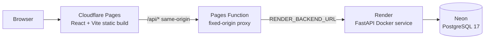

# FinPath

FinPath is a personal finance and goal-planning web application for tracking income, expenses, loans, savings goals, and travel budgets in **Myanmar Kyat (MMK)**. It combines those records into a single backend-calculated available balance, with reports, a CSV export, and a five-tab interface.

Built as a capstone submission for the **AI Dev Tools Zoomcamp**.

## Live Application

| Service | URL |
|---|---|
| Frontend | <https://finpath-website.pages.dev> |
| Backend API | <https://finpath-website.onrender.com> |
| Health check | <https://finpath-website.onrender.com/health> |
| Readiness check | <https://finpath-website.onrender.com/ready> |

The backend runs on Render's free tier, so the first request after a period of inactivity may take tens of seconds while the service wakes.

## The Problem

Personal finance tools often show disconnected numbers: a transaction list in one place, savings goals in another, and loan repayments nowhere near either. That makes it hard to answer a simple question — *how much cash is actually available right now?*

FinPath keeps transactions, loans, savings goals, and trips in one persisted ledger and derives the available balance from explicit rules:

- Loan principal is cash received; repayments are cash out — neither is treated as an expense.
- Savings targets reserve cash; contributions within a target do not deduct it twice.
- Active trips reserve the greater of their planned budget and actual spending; completed or cancelled trips recognize actual spending only.
- Every record is owned by its authenticated user and scoped on the backend.

## Key Features

- **Dashboard** — account balance, all-time and current-month totals, loan and savings summaries, six-month cash-flow and expense-category reports, recent transactions, and CSV export.
- **Transactions** — income and expense CRUD with seeded categories, inclusive date/type/text filters, and cursor pagination.
- **Loans** — principal, repayments, derived outstanding principal, and append-only full-reversal corrections (API).
- **Savings Goals** — goals, contributions, withdrawals, progress, and archive/restore (API).
- **Travel Budget** — trips, category budgets, actual spending, bounded atomic JSON import, completion, and cancellation.
- **Starting balance** — user-defined opening balance plus effective date, protected by ETags.
- **Secure accounts** — Argon2id passwords, JWT access tokens, rotating refresh tokens, CSRF protection, email verification, and owner-scoped data access.

All money is stored and validated as whole-Kyat integers. A single financial entry is capped at **1,000,000,000 MMK**.

## Technology Stack

| Layer | Technology |
|---|---|
| Frontend | React 19, TypeScript 5.8, Vite 6, Tailwind CSS 3.4 |
| Backend | Python 3.11–3.12, FastAPI, Pydantic Settings |
| Database | PostgreSQL 17, SQLAlchemy 2, Alembic, psycopg 3 |
| Auth | Argon2id, PyJWT, opaque rotating refresh tokens |
| Frontend tests | Vitest 3, React Testing Library, jest-dom, jsdom |
| Backend tests | Pytest 8 |
| End-to-end tests | Playwright 1.48 (Chromium) |
| CI | GitHub Actions (CI, scheduled alerting, and on-call diagnosis) |
| Production hosting | Cloudflare Pages, Cloudflare Pages Functions, Render, Neon |

## Architecture



- The browser calls `/api/v1` on the Pages origin; the Pages Function forwards only to the fixed backend origin in `RENDER_BACKEND_URL`, so it cannot act as an open proxy.
- The backend owns all financial logic and authorization. The React app renders API responses and does not keep a second ledger.
- PostgreSQL is the source of truth; a local Docker Compose stack uses the same backend and schema.
- `/health` is a lightweight liveness check; `/ready` reports database readiness.
- Monitoring is a control-plane concern outside the request path: the hourly alerting workflow and the separate read-only on-call agent are configured as GitHub Actions workflows and never sit between the browser and the backend.

## Repository Structure

```text
FinPath/
├── backend/
│   ├── app/                 # FastAPI app, services, models, schemas, core config, observability, on-call agent
│   ├── migrations/          # Alembic revisions (6 revisions, head c4f7a1b9e2d6)
│   ├── tests/               # Pytest suite, including PostgreSQL-backed tests
│   ├── Dockerfile
│   └── README.md            # Detailed backend reference
├── frontend/
│   ├── src/                 # React app, auth, API client, feature sections
│   ├── e2e/                 # Playwright specs and backend launcher
│   ├── functions/api/       # Cloudflare Pages Function proxy
│   ├── public/_routes.json  # Restricts Functions to /api/*
│   └── Dockerfile           # Nginx image for local Compose
├── docker/postgres/         # Local role/init script
├── .github/workflows/ci.yml # CI: backend, frontend, E2E, Docker build, and staging-lite jobs
├── .github/workflows/alerting.yml # Hourly production probes (manual dispatch; merged, no successful run observed yet)
├── .github/workflows/oncall-agent.yml # Read-only on-call diagnosis after a failed alerting run
├── compose.yaml             # Local full-stack Docker Compose
├── PROJECT_SPEC.md          # Product specification (source of truth for behavior)
├── API_CONTRACTS.md         # Endpoint, error, ETag, and idempotency contracts
├── BACKEND_ARCHITECTURE.md  # Schema, privilege matrix, and design decisions
├── docs/ALERTING_RUNBOOK.md # Alerting probes, severities, and investigation steps
└── docs/ONCALL_RUNBOOK.md   # On-call classification, fixture repairs, verification, and limitations
```

## Prerequisites

| Tool | Version |
|---|---|
| Python | 3.11 or 3.12 |
| Node.js | 18+ for the Vite app; 22+ for the Wrangler/Pages tooling |
| npm | Included with Node.js |
| PostgreSQL | 17 (native setup) |
| Docker Desktop | Optional, for the full-stack Compose setup |

CI uses Python 3.12 and Node.js 22.

## Local Development

Two local paths are supported. **Docker Compose** is the fastest way to run the complete stack. The **native setup** runs PostgreSQL, the backend, and the Vite dev server directly.

### Option A: Docker Compose (full stack)

Create the Compose environment file and replace every placeholder with unique local values:

```sh
cp .env.docker.example .env
docker compose up --build
```

The stack starts PostgreSQL, the FastAPI backend, and the production frontend build:

| Service | URL |
|---|---|
| Frontend | `http://localhost:8080` |
| Backend API | `http://localhost:8000/api/v1` |
| API docs | `http://localhost:8000/docs` |
| Backend health | `http://localhost:8000/health` |

The backend container applies migrations and the idempotent reference seed at startup (`FINPATH_RUN_STARTUP_MIGRATIONS=true`). Stop the stack with `docker compose down`; data remains in the `finpath_postgres_data` volume. `docker compose down -v` permanently deletes that volume.

### Option B: Native local setup

#### 1. Create the local database and roles

The app uses three least-privilege PostgreSQL identities:

- `finpath_migrator` — owns the schema and runs migrations/seeding.
- `finpath_app` — runtime identity for authenticated application traffic.
- `finpath_registration` — narrow identity used only for registration writes.

Connect as a PostgreSQL superuser and run the equivalent of the local init script:

```sh
psql -d postgres -c "CREATE ROLE finpath_migrator LOGIN NOSUPERUSER NOCREATEDB NOCREATEROLE NOREPLICATION NOBYPASSRLS PASSWORD '<migrator-password>';"
psql -d postgres -c "CREATE ROLE finpath_app LOGIN NOSUPERUSER NOCREATEDB NOCREATEROLE NOREPLICATION NOBYPASSRLS PASSWORD '<app-password>';"
psql -d postgres -c "CREATE ROLE finpath_registration LOGIN NOSUPERUSER NOCREATEDB NOCREATEROLE NOREPLICATION NOBYPASSRLS PASSWORD '<registration-password>';"
psql -d postgres -c "CREATE DATABASE finpath OWNER finpath_migrator;"
psql -d finpath -c "ALTER SCHEMA public OWNER TO finpath_migrator;"
psql -d finpath -c "GRANT USAGE, CREATE ON SCHEMA public TO finpath_migrator;"
psql -d finpath -c "GRANT CONNECT ON DATABASE finpath TO finpath_app, finpath_registration;"
```

Use unique local passwords and keep them only in `backend/.env`.

#### 2. Install and configure the backend

```sh
cd backend
python3 -m venv .venv
source .venv/bin/activate
python -m pip install --upgrade pip
python -m pip install -e ".[dev]"
cp .env.example .env
```

Edit `backend/.env` with the three database URLs and a long random `FINPATH_ACCESS_TOKEN_SECRET`. For immediate local sign-up, set `FINPATH_REQUIRE_EMAIL_VERIFICATION=false`; the default `outbox` email backend writes verification messages to `var/email_outbox` instead of sending them.

#### 3. Apply migrations and seed reference data

```sh
cd backend
.venv/bin/alembic upgrade head
.venv/bin/python -m app.db.seed
```

`FINPATH_MIGRATION_DATABASE_URL` must point at the database as `finpath_migrator`. The seed is idempotent and inserts the `user` and `admin` roles plus 11 transaction categories. The current Alembic head is `c4f7a1b9e2d6`.

#### 4. Start the backend

```sh
cd backend
source .venv/bin/activate
uvicorn app.main:app --reload
```

The API listens on `http://127.0.0.1:8000`. Swagger UI is available at `/docs` in development.

#### 5. Start the frontend

```sh
cd frontend
npm install
cp .env.example .env.local
npm run dev
```

The Vite dev server normally runs at `http://localhost:5173`. `VITE_API_BASE_URL` defaults to `http://localhost:8000/api/v1` if unset.

## Environment Configuration

Never commit `.env` files or real secrets. Names only:

| Variable | Scope | Purpose |
|---|---|---|
| `FINPATH_DATABASE_URL` | Backend | Runtime URL as `finpath_app` |
| `FINPATH_MIGRATION_DATABASE_URL` | Backend | Migration/seed URL as `finpath_migrator` |
| `FINPATH_REGISTRATION_DATABASE_URL` | Backend | Registration URL as `finpath_registration` |
| `FINPATH_ACCESS_TOKEN_SECRET` | Backend | Long random JWT signing secret; startup fails without it |
| `FINPATH_REQUIRE_EMAIL_VERIFICATION` | Backend | Enforces verified email; defaults to `true` |
| `FINPATH_ALLOW_UNVERIFIED_REGISTRATION` | Backend | Explicit opt-in for a no-email deployment only |
| `FINPATH_FRONTEND_ORIGINS` | Backend | Comma-separated allowed browser origins |
| `FINPATH_MAX_FINANCIAL_ENTRY_KYAT` | Backend | Per-entry cap; defaults to `1000000000` |
| `FINPATH_EMAIL_BACKEND` | Backend | `outbox` locally; `resend` for production email |
| `FINPATH_RESEND_API_KEY` | Backend | Resend secret, when email delivery is enabled |
| `FINPATH_EMAIL_FROM` | Backend | Verified Resend sender address |
| `FINPATH_RUN_STARTUP_MIGRATIONS` | Backend | Runs migrations/seed on container start; local Docker only |
| `FINPATH_METRICS_ENABLED` | Backend | Enables the `/metrics` endpoint; defaults to `false` |
| `FINPATH_METRICS_TOKEN` | Backend | Bearer token required by `/metrics` when enabled; optional, and the endpoint fails closed when it is unset |
| `VITE_API_BASE_URL` | Frontend build | API base; `/api/v1` in production, localhost URL locally |
| `RENDER_BACKEND_URL` | Pages Function | Fixed backend origin for the same-origin proxy |

Production uses the same backend variable names but with production values, verification enabled (or an explicit unverified-registration opt-in), secure cookies, and migrations applied from a trusted environment rather than on every Render cold start.

## Running Tests

### Frontend unit and component tests

```sh
cd frontend
npm run test:run     # single run
npm run test         # watch mode
```

### Frontend type check and production build

```sh
cd frontend
npm run build        # tsc -b && vite build
```

### Backend tests

```sh
cd backend
source .venv/bin/activate
pytest
```

Focused examples:

```sh
pytest tests/test_auth_postgres.py
pytest tests/test_travel_postgres.py
```

Backend PostgreSQL tests require the three `FINPATH_TEST_*` URLs documented in `backend/.env.example`; they use disposable schemas and skip when the test database is not configured. They never target the development database.

### On-Call Agent tests

```sh
cd backend
source .venv/bin/activate
pytest tests/test_oncall_agent.py -q
```

These tests cover failure classification, malformed and conflicting alert summaries, the repair allowlist, fixture-only patch generation, and verification gating. The focused local suite reports **95 passed and 2 skipped**; CI run `43696552654` for commit `9719671` passed all five jobs (backend: **543 passed, 2 skipped**). The two skipped tests are simulation-only and are exercised by the local CLI simulation.

### End-to-end tests

```sh
cd frontend
npx playwright install --with-deps chromium
npm run test:e2e
```

Playwright starts the backend against the dedicated test database via `frontend/e2e/start-backend.sh`, then starts the Vite dev server. It requires `backend/.venv` and the `FINPATH_TEST_*` settings in `backend/.env`. Tests run serially on Chromium.

### Verified CI test counts

From GitHub Actions run `43174534132` on **2026-11-12** at commit `45527fffe2fa36e4a0c90dd4f9592aff188be1bf`:

| Suite | Result |
|---|---|
| Backend (Pytest, PostgreSQL 17) | 250 passed in 55.46 s |
| Frontend (Vitest, 19 files) | 316 passed; type check and build succeeded |
| End-to-end (Playwright, Chromium) | 10 passed in 31.4 s across 5 spec files |

These counts are a snapshot of that run and may change as the project evolves.

## Deployment Overview

The production architecture targets a zero-cost stack:

| Provider | Responsibility |
|---|---|
| Cloudflare Pages | Serves the Vite build and the public HTTPS site |
| Pages Function | Proxies `/api/*` to the backend; configured by `RENDER_BACKEND_URL` |
| Render | Runs the FastAPI Docker image and supplies `PORT` |
| Neon | Hosts PostgreSQL 17 with separate runtime, registration, and migration roles |

Operational notes:

- Pages build: root `frontend`, build command `npm run build`, output `dist`, build variable `VITE_API_BASE_URL=/api/v1`.
- The Pages proxy preserves method, path, query, body, auth/CSRF/idempotency headers, and multiple `Set-Cookie` headers; it never accepts an upstream from the request.
- Render uses `/health` as its health-check path; `/ready` reports database readiness. Startup migrations are disabled with `FINPATH_RUN_STARTUP_MIGRATIONS=false`.
- Migrations are applied separately with `FINPATH_MIGRATION_DATABASE_URL` as `finpath_migrator` against a direct Neon connection.
- GitHub Actions builds and tests through `ci.yml`, hosts the separate hourly alerting workflow and the read-only on-call diagnosis workflow; none of these workflows deploys. Neither the alerting nor the on-call workflow has executed yet.

## Observability

FinPath correlates and describes its own runtime behavior without external monitoring infrastructure. This is request correlation and in-process metrics, not distributed tracing.

- **Request correlation** — the frontend sends a validated `X-Request-ID` header on each API request; the backend accepts a valid value or generates one, echoes it in the response, and attaches it to that request's structured log records. Failed requests keep the ID for correlation. The ID is a diagnostic value only and is never used for authentication or as user identity.
- **Structured domain events** — the backend emits allowlisted, privacy-safe domain events, such as login outcomes and transaction, loan, savings, travel, and report actions. Event names and authentication-failure reasons are fixed, messages are static, and no user or financial data is included.
- **Prometheus metrics** — the backend registers bounded HTTP request, request-duration, and slow-request metrics in the Prometheus text format. Route, method, and status labels come from fixed vocabularies, so raw paths, identifiers, and amounts never become labels.

The metrics endpoint (`/metrics`) is **disabled by default** and is protected by an optional bearer token; when enabled without a valid token it fails closed. No metrics are currently collected in production, and there is no monitoring dashboard or tracing platform. Metrics are held in process, so counters reset when the backend restarts and are not shared across instances.

**User-impact alerting.** Four synthetic probes (`frontend`, `backend_health`, `backend_ready`, `auth_smoke`) are configured to check the production deployment hourly, and a failed workflow run is the alert. The evaluator, standard-library runner, and GitHub Actions workflow are implemented in the repository, but scheduled alerting is **not yet verified active**: the workflow is merged and registered, but no scheduled or manual run has executed yet. See [docs/ALERTING_RUNBOOK.md](docs/ALERTING_RUNBOOK.md) for probes, severities, retries, exit codes, and safe investigation steps.

A separate deterministic on-call agent can read a failed alerting run's safe summary and publish a diagnosis; it never changes production code or deploys. See [On-Call Agent](#on-call-agent) and [docs/ONCALL_RUNBOOK.md](docs/ONCALL_RUNBOOK.md).

## On-Call Agent

FinPath includes a **deterministic, rule-based on-call diagnosis agent** for failed production alerting runs. It is **not an LLM** and it is not fully autonomous: it classifies the safe alert summary, publishes a diagnosis for human review, and can repair only an isolated test fixture.

**Relationship to production alerting**

- The hourly `alerting` workflow is configured to run four synthetic production probes; a failed run is the alert. No scheduled or manual alerting run has executed yet.
- The separate `.github/workflows/oncall-agent.yml` workflow is configured to start on a failed alerting run (`workflow_run`) and can also be started manually with `workflow_dispatch`.
- The on-call workflow is read-only (`contents: read`, `actions: read`), uses no secrets, and never creates Issues, comments, branches, pull requests, commits, or deployments.

```text
alerting workflow (hourly or manual)
  → failed run
    → on-call agent (read-only)
      → diagnosis report + optional fixture patch
        → human review
```

**Classification and escalation**

- The agent retrieves only the failed run's allowlisted summary (`status`, `severity`, `failed_probes`, and per-probe error kinds). It rejects malformed, unknown, or conflicting summaries.
- Known failures map to explicit categories: frontend/deployment status, root-marker or response contract, provider outage, backend liveness, readiness/database, authentication Origin/proxy configuration, monitoring/configuration, or unknown.
- Provider timeouts, connection failures, backend readiness/liveness failures, authentication configuration faults, and unknown failures **escalate** to the owner. The agent does not invent a code fix for them.

**Fixture-only bounded repair**

- Only for deliberately broken, isolated fixtures under `backend/tests/fixtures/oncall/`, the agent generates a unified diff, applies the fixed content in an ephemeral work directory, and runs a fixed focused test.
- It reports `repair_verified` only when that test positively passes. Failed, skipped, empty, or inconclusive verification is reported as `repair_unverified`.
- The repair allowlist excludes application code, authentication, financial logic, migrations, CI/workflows, secrets, and production configuration. Human review is required before any patch is used.

**Verification status**

- **Verified by local CLI simulation:** the frontend-marker and auth-origin fixtures produce a patch, apply it to an ephemeral directory, and pass the focused test; the readiness-outage scenario escalates without a patch; a sample failed-run log produces a safe diagnosis. The GitHub Actions on-call workflow has not been run, so its manual `workflow_dispatch` path is not yet exercised.
- **Not yet verified:** the native automatic `workflow_run` trigger. The workflow is committed on the default branch and statically validated, but neither a native failure-triggered run nor a manual `workflow_dispatch` run has been executed, so do not treat automatic diagnosis as live yet.
- The implementation is committed at [`9719671`](https://github.com/alicephoo/FinPath_Website/commit/9719671). CI run [`43696552654`](https://github.com/alicephoo/FinPath_Website/actions/runs/43696552654) passed all five jobs for that commit (backend: **543 passed, 2 skipped**). The focused local on-call suite reports **95 passed and 2 skipped**, and the local alerting suites report **90 passed**; the two simulation-only skips are exercised by the local CLI simulation.

See [docs/ONCALL_RUNBOOK.md](docs/ONCALL_RUNBOOK.md) for the classification table, repair allowlist, artifacts, security restrictions, and local CLI simulation commands.

## Security and Data Handling

Implemented:

- Argon2id password hashing and a 12-character minimum password length.
- 15-minute JWT access tokens and 30-day, HttpOnly, `SameSite=Lax` refresh cookies scoped to `/api/v1/auth`.
- Refresh-token rotation with session-family revocation on reuse.
- CSRF tokens for cookie-authenticated operations and trusted-origin checks on login, refresh, logout, and CSRF issuance.
- Owner-scoped SQL for every financial read and write; another user's record returns `404`.
- ETag/`If-Match` optimistic concurrency, scoped idempotency keys, and sanitized error envelopes with request IDs.
- Column-level database privileges and three separate least-privilege database identities.
- Production startup rejects insecure verification or cookie configurations.
- The on-call diagnosis workflow is read-only (`contents: read`, `actions: read`), uses no secrets, and cannot modify production code or deploy.

Not implemented: application rate limiting, multi-factor authentication, passkeys, social login, PostgreSQL row-level security, an email-change flow, and the Admin console. See `PROJECT_SPEC.md` for the full security model and known gaps.

Financial data is stored in PostgreSQL and survives refreshes, restarts, and sign-outs. The frontend treats API responses as its source of truth. No bank connections, interest calculations, amortization, or multi-currency support are provided.

## Current Limitations and Deferred Features

- **Admin is deferred** — no Admin API, account-management screens, role-assignment UI, or audit-log browser. The `admin` role and append-only audit table exist in the schema, but no Admin functionality exposes them.
- **Rate limiting is not implemented** — authentication and write endpoints are not throttled.
- **Savings archive/restore is API-only** — the Savings Goals UI does not expose those actions.
- **Loan repayment corrections are API-only** — the Loans UI shows corrected status but has no correction action.
- **Password change and password reset are API-only** — the current UI does not expose those screens.
- **No email change, MFA, passkeys, social login, or RLS.**
- **No loan or savings-goal deletion** — cancellation/archive semantics preserve history.
- **Categories are fixed** to 11 seeded reference rows.
- **CSV is the only export format.**
- **Playwright runs Chromium only.**
- **Render free-tier cold starts** can delay the first request.
- **On-call automatic triggering is unverified** — the `workflow_run` workflow is configured and statically validated, but neither a native failure-triggered run nor a manual `workflow_dispatch` run has executed. Local CLI simulations are verified.
- **On-call repairs are fixture-only** — the agent never modifies production application code; production failures are diagnosed and escalated for human remediation.
- **The on-call agent is deterministic, not an LLM** — novel failures are classified as unknown and escalated, and there is no on-call rotation or autonomous remediation.

## Task Tracking

Active development tasks are tracked on the public [FinPath — Development Tracker](https://github.com/users/alicephoo/projects/1). Each draft task records its context, scope and non-goals, acceptance criteria, responsible agent role, and implementation/verification evidence. `TASKS.md` is a historical checklist; current task status lives on the board and in `PROGRESS.md`.

## Documentation

| Document | Contents |
|---|---|
| [PROJECT_SPEC.md](PROJECT_SPEC.md) | Product specification, financial rules, requirements, and verified status |
| [FinPath — Development Tracker](https://github.com/users/alicephoo/projects/1) | Public project board for active tasks, acceptance criteria, roles, and evidence |
| [API_CONTRACTS.md](API_CONTRACTS.md) | Endpoint contracts, error envelopes, ETags, and idempotency |
| [BACKEND_ARCHITECTURE.md](BACKEND_ARCHITECTURE.md) | Schema, protection matrix, and deferred design decisions |
| [backend/README.md](backend/README.md) | Detailed backend setup, API reference, and database roles |
| [AGENTS.md](AGENTS.md) | Repository instructions for AI agents: context precedence, agent team, workflow, safety, and approval gates |
| [AI_WORKFLOW.md](AI_WORKFLOW.md) | AI-assisted development workflow |
| [docs/ALERTING_RUNBOOK.md](docs/ALERTING_RUNBOOK.md) | Production alerting probes, severities, retries, exit codes, investigation, and activation |
| [docs/ONCALL_RUNBOOK.md](docs/ONCALL_RUNBOOK.md) | Deterministic on-call classification, fixture-only repairs, verification, security, and limitations |
| [TASKS.md](TASKS.md) | Historical ordered task checklist |
| [PROGRESS.md](PROGRESS.md) | Current progress, dated evidence, and rubric status; `PROJECT_SPEC.md` is authoritative for current behavior |

## License

No license file is currently included in this repository.
